# Linux Permission Audit & Privilege Escalation Lab

## Overview

This project demonstrates practical Linux auditing and threat hunting skills on an Ubuntu virtual machine. Instead of analyzing authentication logs, this lab takes the perspective of a Security Auditor.

The objective was to establish a secure baseline, simulate a common administrative misconfiguration (a world-writable system file), hunt for the vulnerability using native Linux tools, perform incident response, and verify the remediation.

## Environment

- **OS:** Ubuntu LTS
- **Platform:** Oracle VirtualBox
- **Tools Used:** `find`, `ls`, `grep`, `getcap`, `chmod`

## The Scenario

1. **System Baseline:** Verified user privileges (`id`, `sudo -l`) and confirmed the system had no world-writable root files.
2. **Vulnerability Injection:** Simulated an admin error by creating a configuration file and applying `chmod 777` to it.
3. **Threat Hunting:** Used `find` and `grep` pipelines to cut through system noise and locate the vulnerable file, along with auditing SUID binaries.
4. **Remediation:** Fixed the file permissions, deleted the simulated file, and re-ran the hunt to mathematically prove the system was secure again.

## Key Investigation Outcomes

- Proved that default Ubuntu installations are secure against basic world-writable attacks.
- Successfully detected a simulated world-writable root file using targeted `find` and `grep` filters.
- Audited the system for SUID binaries and Linux Capabilities.

_(See [findings-and-risk.md](findings-and-risk.md) for the full breakdown)._

## Investigation Walkthrough

### Step 1: Baseline & Identity

Before auditing, we established what "normal" looks like and verified current privileges.

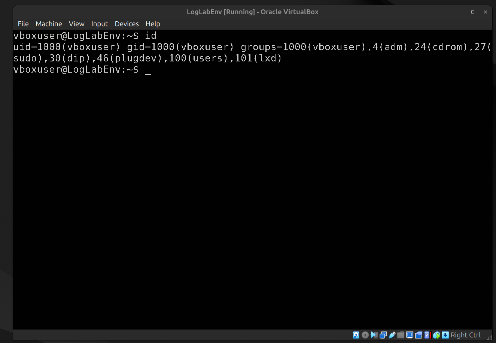
_Checking current user privileges._

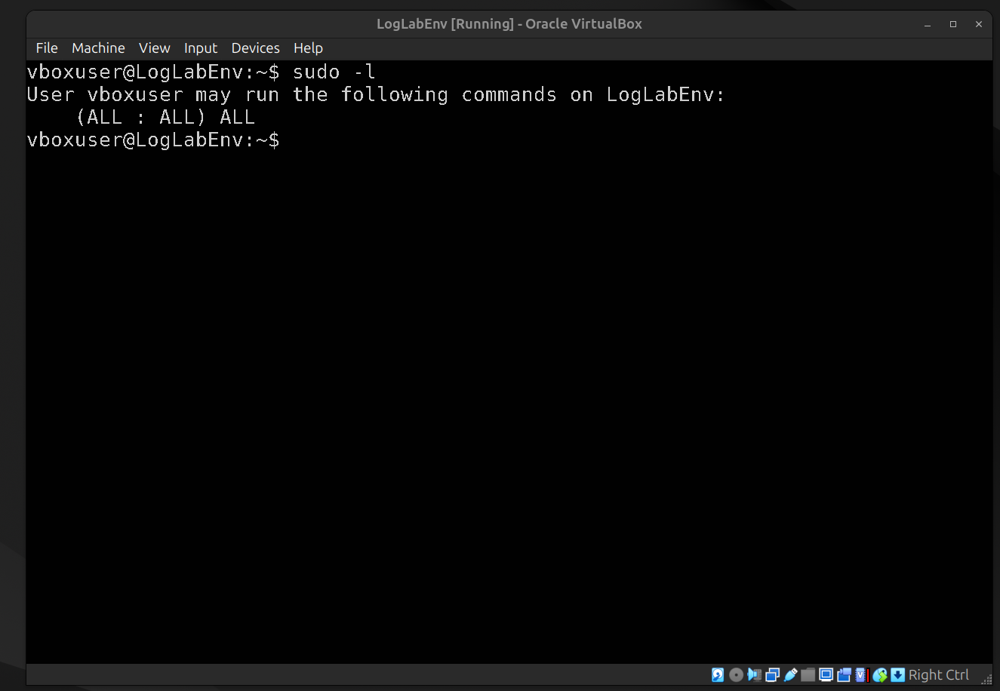
_Reviewing sudo permissions._

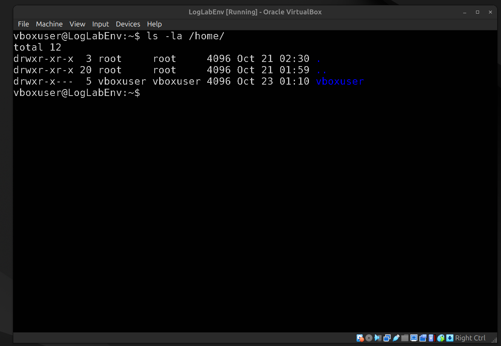
_Auditing user home directories._

### Step 2: Baseline Hunt (Clean System)

We ran the world-writable hunt to prove the system was initially secure.

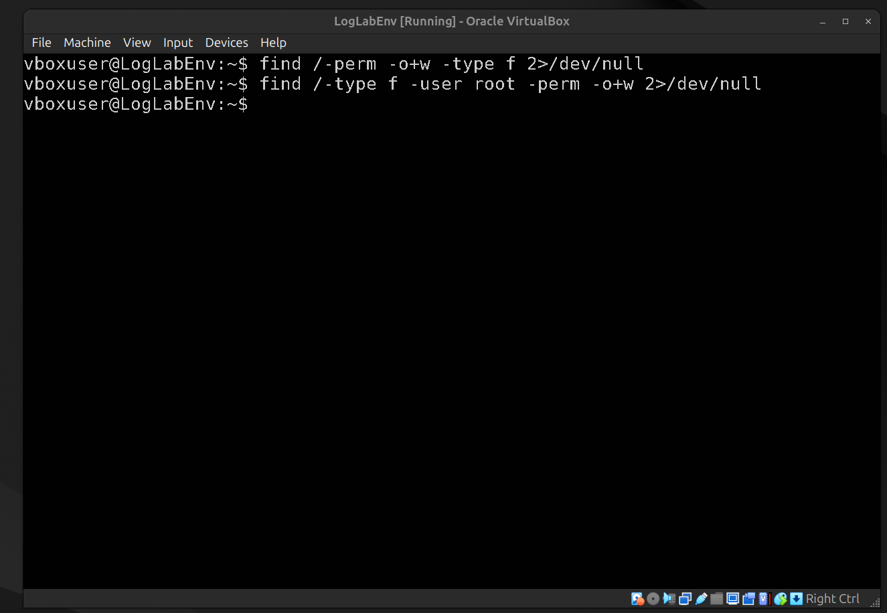
_The `find` command returns nothing, proving no world-writable files exist._

### Step 3: Vulnerability Injection

We simulated an administrative error by making a system file fully writable by anyone.

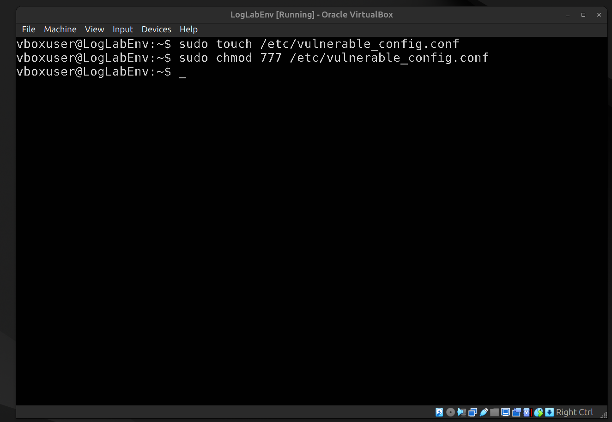
_Applying the insecure `chmod 777` to the test file._

### Step 4: Threat Hunting (Finding the Flaw)

We ran the hunt again. The first output shows the raw list, and the second shows our filtered, high-risk results.

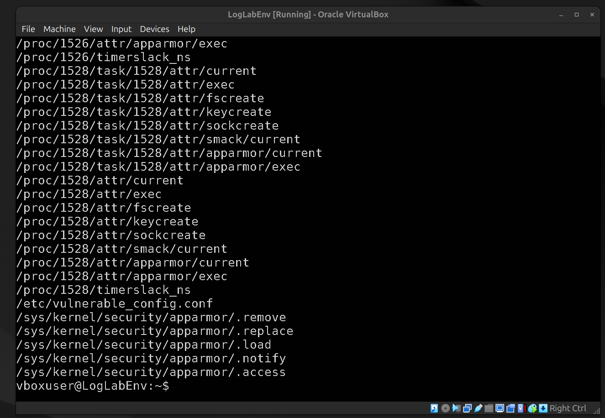
_The initial `find` command showing the vulnerable file._

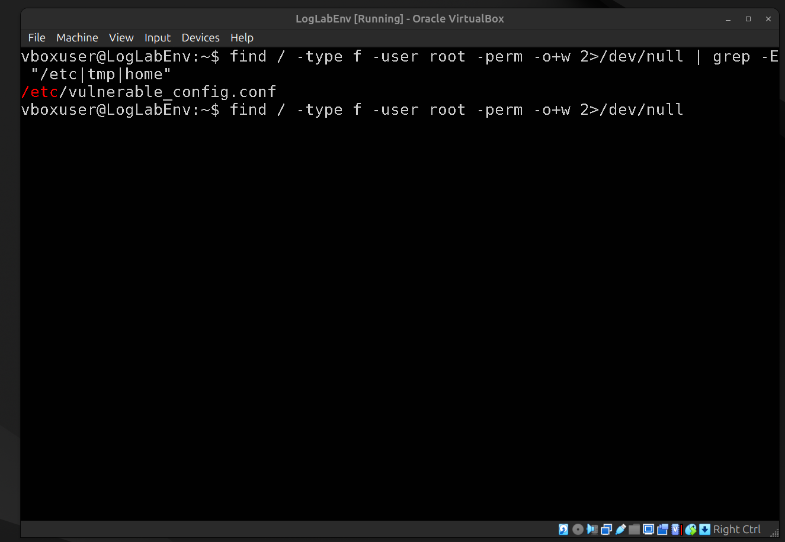
_Using `grep` to filter the output and highlight the vulnerability in `/etc`._

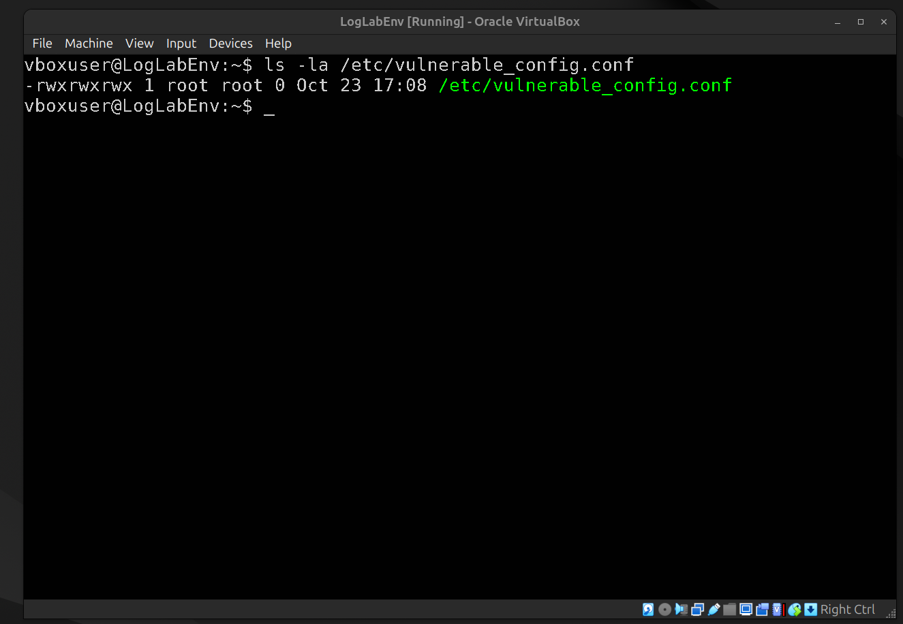
_Verifying the dangerous `rwxrwxrwx` permissions._

### Step 5: SUID & Capabilities Audit

We searched for files with elevated execution privileges.

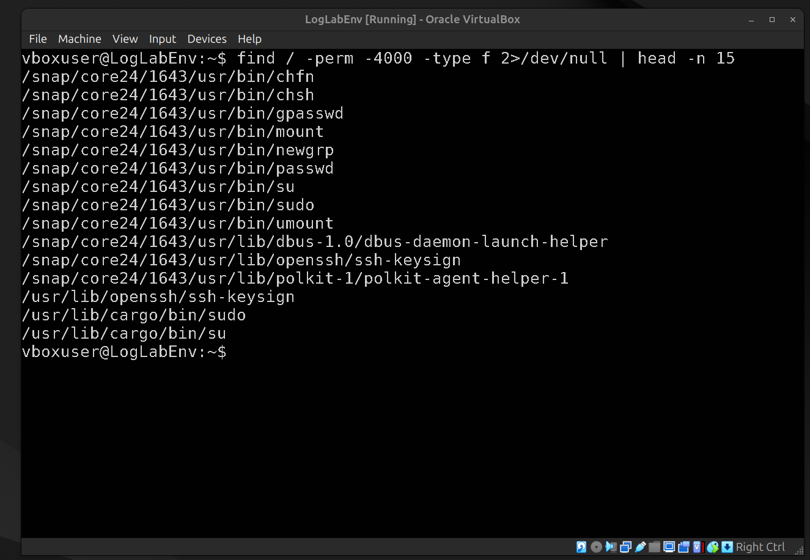
_Reviewing SUID binaries._

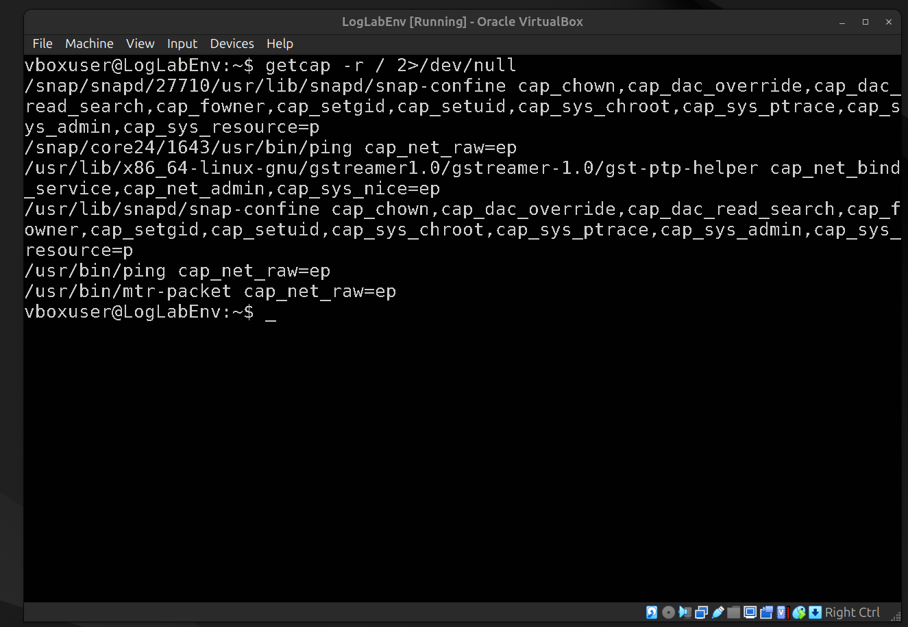
_Auditing Linux Capabilities._

### Step 6: Remediation & Verification

We fixed the vulnerability and re-ran the scan to prove the system was secured.

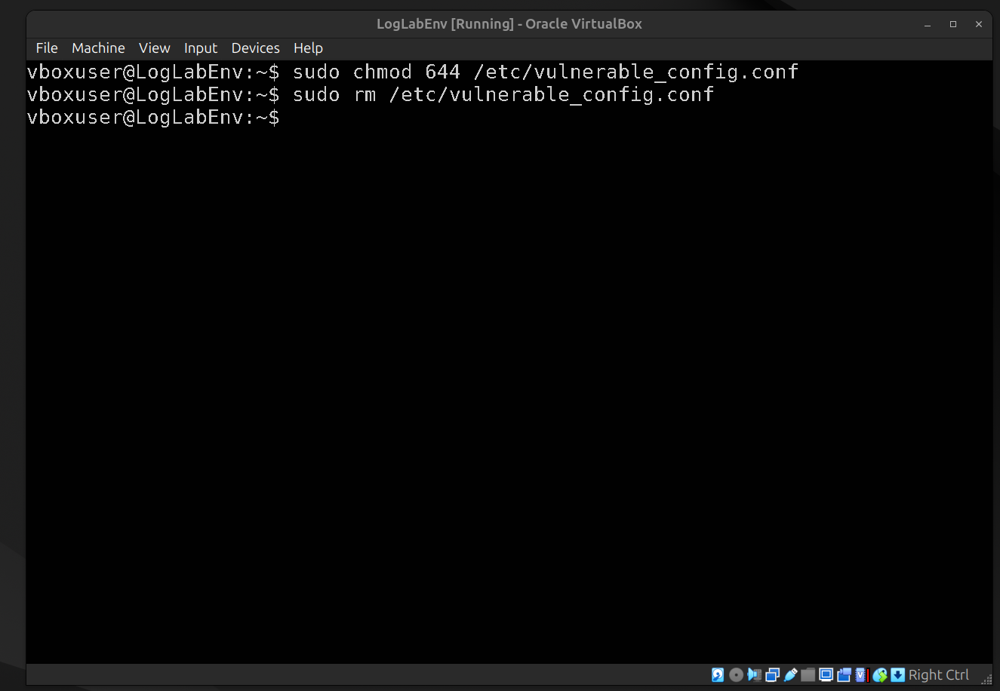
_Changing the permissions and removing the file._

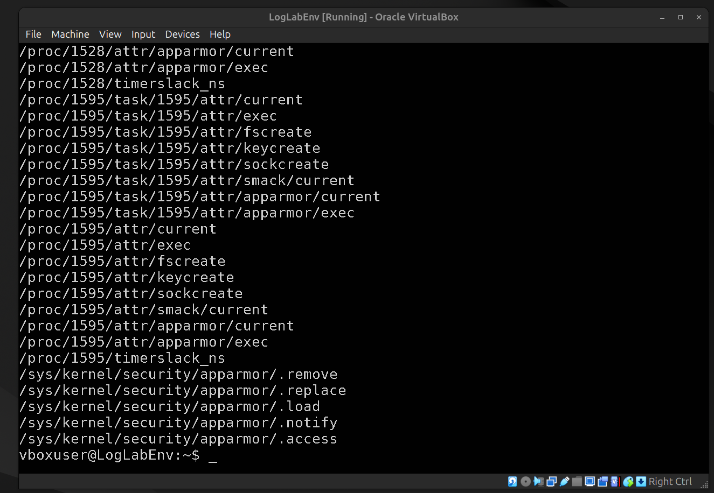
_Initial verification check._

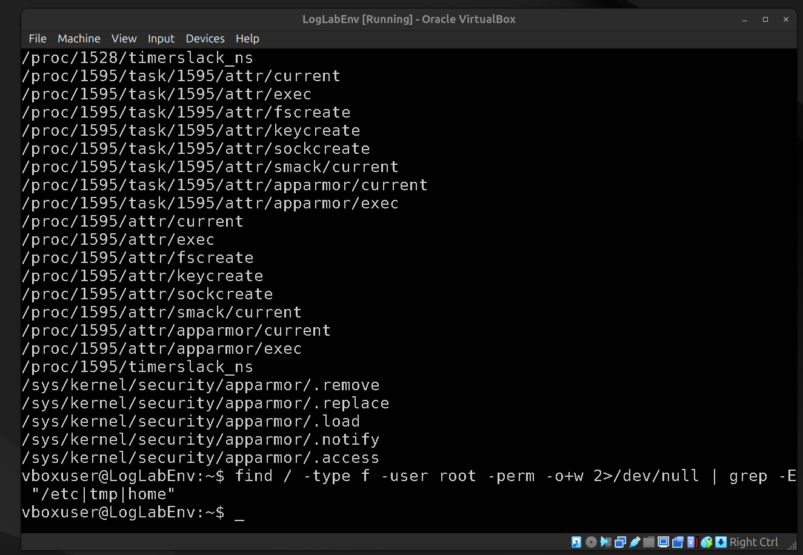
_The final `find` command returns blank, confirming the flaw is gone._

## Lessons Learned

- **Trust, but verify:** Remediation is not complete until you re-run the vulnerability scan to prove the issue is gone.
- **The Danger of `chmod 777`:** It is a common shortcut for beginners to fix "Permission Denied" errors, but it creates a massive backdoor for privilege escalation.
- **Filtering the Noise:** A standard `find /` query is overwhelming. Piping the output to `grep -E` or `head` is essential for highlighting only the high-risk findings.

## Remediation

See [remediation.md](remediation.md) for defense-in-depth recommendations.
