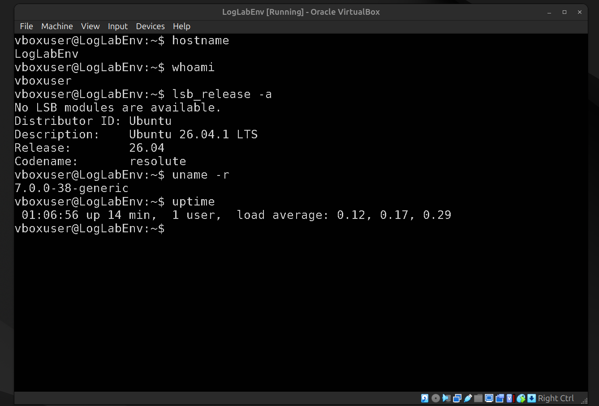
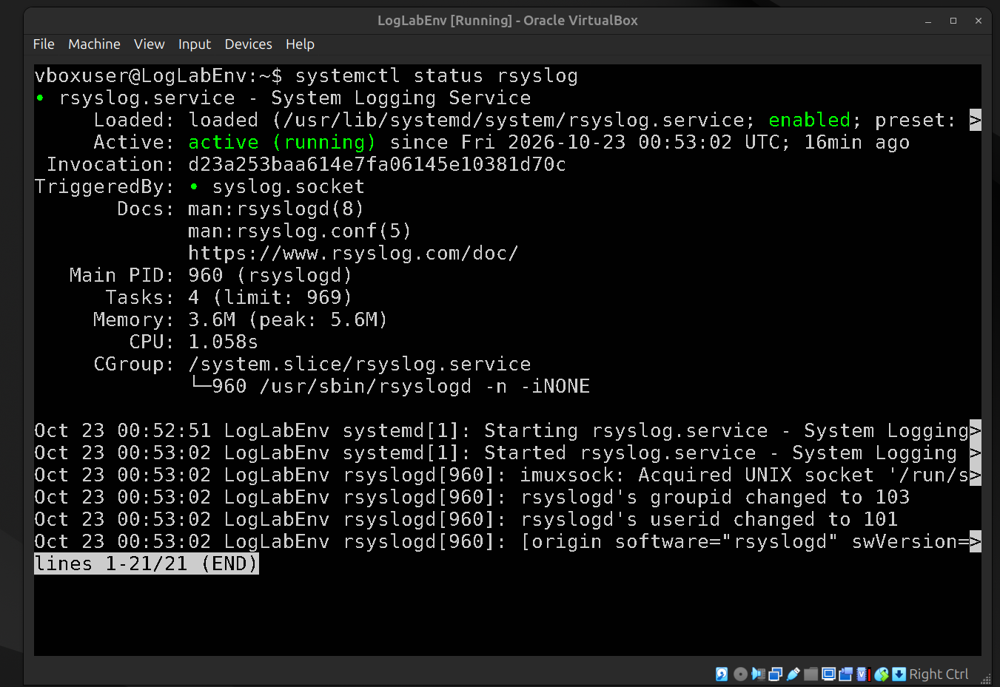
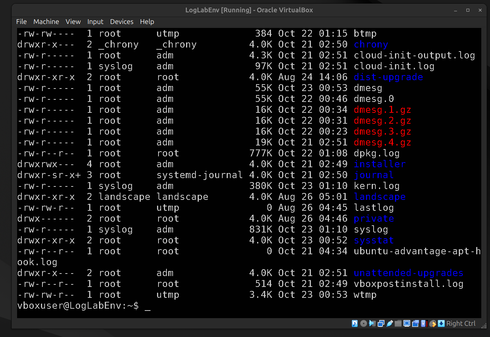
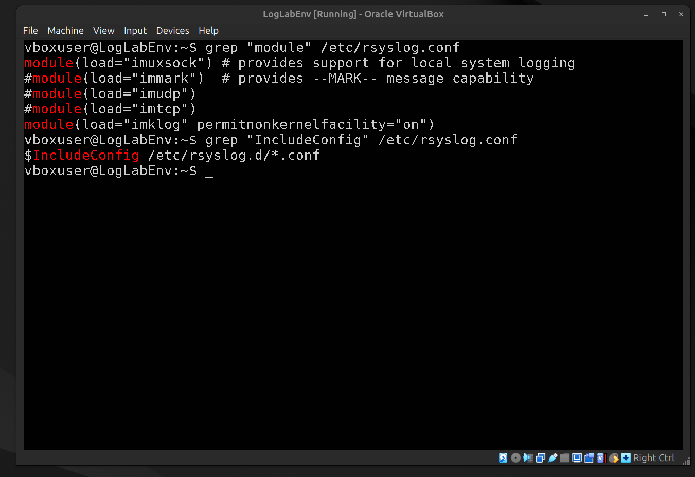
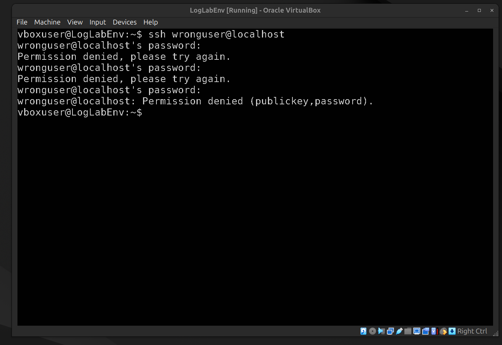
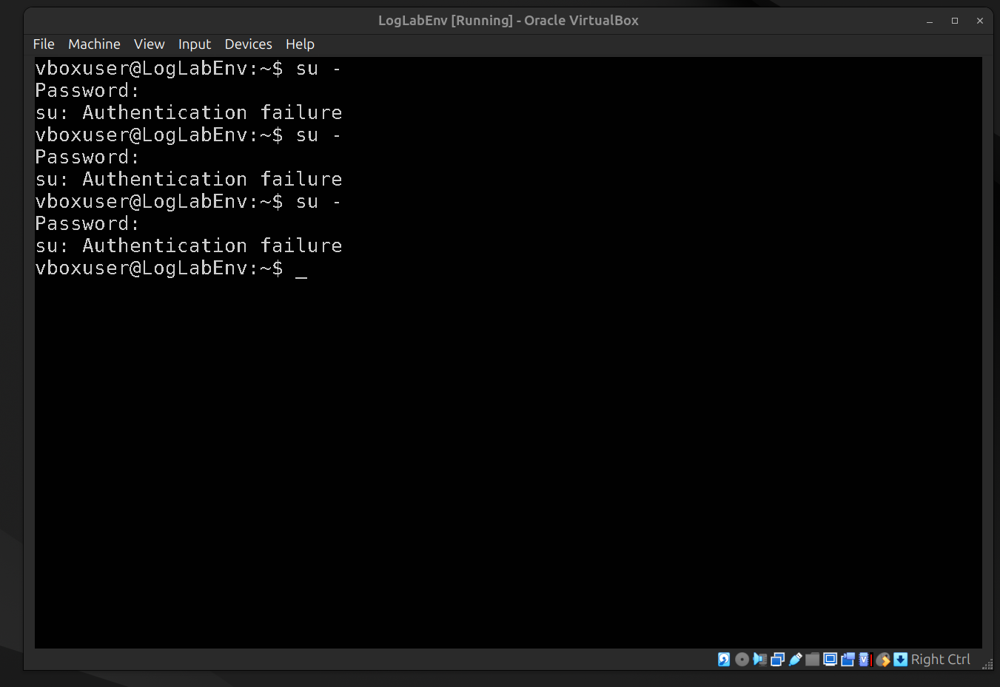
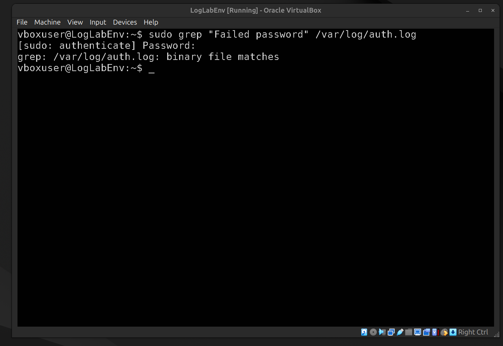
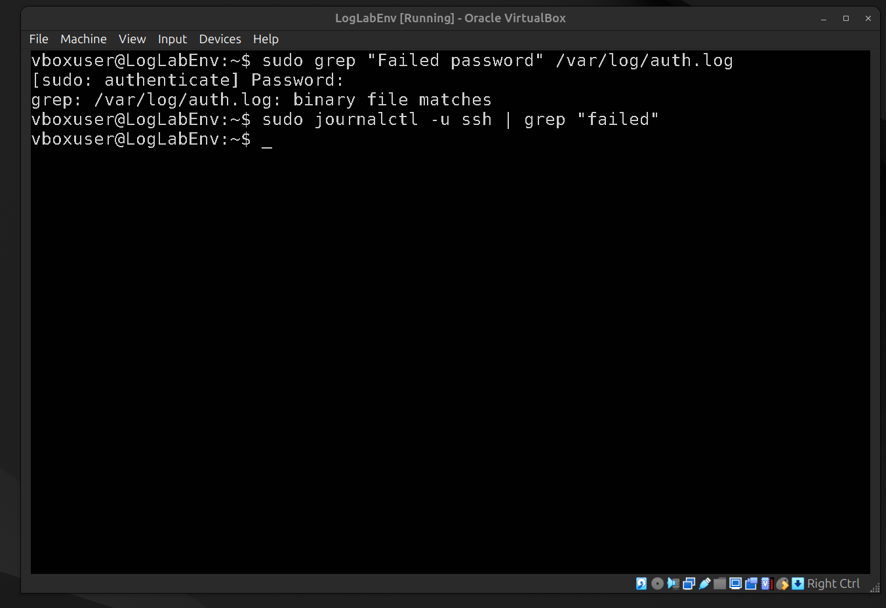
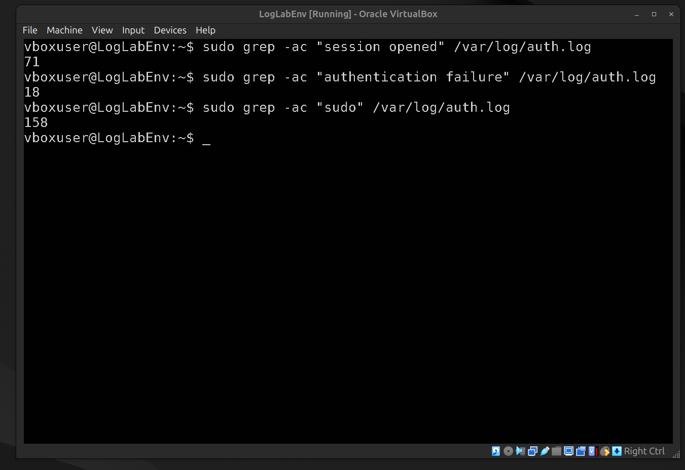
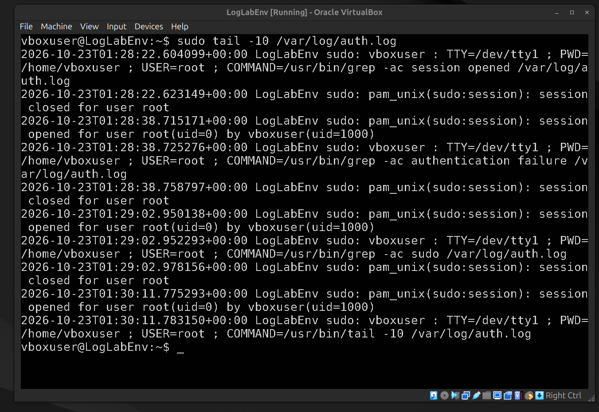

# Linux Syslog Security Monitoring Lab

## Overview

This project demonstrates practical Security Operations Center (SOC) skills on an Ubuntu 24.04+ LTS virtual machine. The objective was to simulate an attacker, generate authentication and privilege escalation logs, investigate the evidence using native Linux tools, and map the findings to the MITRE ATT&CK framework.
By acting as both the attacker and the defender, this lab highlights how security events are generated, how to hunt through logs to find them, and how to document findings for incident response.

## Environment

- **OS:** Ubuntu 24.04 LTS (Logged as 26.04 LTS in the simulation)
- **Hostname:** LogLabEnv
- **Platform:** Oracle VirtualBox
- **Tools Used:** `journalctl`, `grep`, `awk`, `systemctl`

## The Scenario

1. **System Baseline:** Verified the host identity, kernel version, and logging daemons (`rsyslog` / `systemd-journald`).
2. **Attack Simulation:** Executed failed SSH logins, a failed `sudo` attempt, and a successful `su -` to root to generate security events.
3. **Investigation:** Hunted through system logs using `journalctl` to attribute the activity, calculate event counts, and extract IOCs.
4. **Documentation:** Mapped the simulated attacker behavior to MITRE ATT&CK and formulated remediation strategies.

## Key Investigation Outcomes

- Detected **18** failed authentication events and **3** incorrect password attempt.
- Identified **158** `sudo` events, confirming administrative activity.
- Successfully bypassed the "binary file" error in `/var/log/auth.log` by utilizing `journalctl`.

(See [findings-and-risk.md](./findings-and-risk.md) for the full breakdown).

## Investigation Walkthrough

### Step 1: System Baseline & Preparation

Before hunting for threats, it is crucial to establish a baseline of the environment. We verified the host identity, OS version, and ensured the system logging daemon (`rsyslog`) was active and healthy.

_Verifying hostname, user, and OS version._

_Confirming `rsyslog` is active (running) to ensure log visibility._

### Step 2: Logging Infrastructure Analysis

We inspected the `/var/log/` directory to locate evidence files and reviewed the `rsyslog` configuration to understand where logs are routed.

_Analyzing the `/var/log` directory to identify available log sources._

_Reviewing rsyslog configuration modules._

### Step 3: Attack Simulation (Generating Evidence)

To simulate an incident, we acted as an attacker. We generated failed SSH login attempts to simulate a brute-force attack and tested privilege escalation.

_Simulating a brute-force attack via failed SSH logins._

_Simulating a failed privilege escalation attempt using `su -`._

### Step 4: Log Investigation & Event Correlation

With the evidence generated, we pivoted to the logs. We encountered a "binary file" error using standard `grep` on `/var/log/auth.log`. We successfully bypassed this by using `journalctl` to query the `systemd-journald` binary logs directly.

_Encountering the binary log issue with standard grep._

_Using `journalctl` to successfully hunt and extract failed SSH logins._

### Step 5: Metrics & Privileged Activity Audit

We quantified the security events and audited privileged account activity to determine if any escalation was successful.

_Quantifying security events (sessions, auth failures, sudo) to build incident metrics._

_Auditing recent privileged (sudo) activity and command execution._

## Lessons Learned

- **The Ubuntu 24.04 Shift:** I learned that modern Ubuntu deprecates traditional `/var/log/auth.log` in favor of `systemd-journald`. Standard `grep` commands on text files returned binary formatting errors. I successfully pivoted to using `journalctl -u` and `-g` to query logs directly.
- **Troubleshooting:** Encountered and resolved a `dpkg was interrupted` lock error during the installation of the SSH server, proving the ability to troubleshoot broken package managers.
- **Log Noise:** Analyzed the difference between event volume and actual security signal. A simple typo in a password looks identical in the logs to a malicious brute-force attempt without context.

## Remediation

See [remediation.md](remediation.md) for defense-in-depth recommendations based on the simulated attack.
