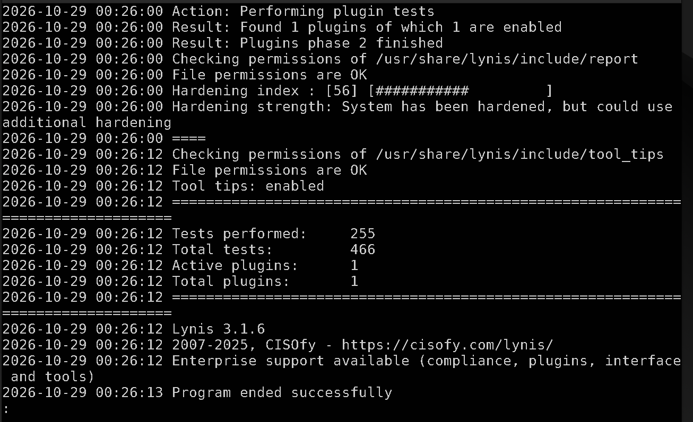
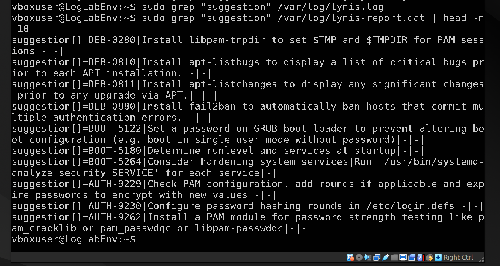

# Linux Vulnerability Assessment & Hardening Audit

## Overview

This project demonstrates a host-based vulnerability assessment on an Ubuntu server using Lynis, an industry-standard security auditing tool. The objective was to perform a compliance audit, identify misconfigurations and missing patches, and generate a prioritized remediation plan.

## The Evidence

- **Environment:** Headless Ubuntu Server VM.
- **Tools Used:** Lynis (Open Source Security Auditing Tool).

## The Scenario

As a security auditor, a comprehensive scan was run against the target server to evaluate its security posture against best practices (CIS benchmarks).

## Investigation Walkthrough

### Phase 1: The Scan Execution

Lynis was executed with root privileges to perform a deep system audit (`sudo lynis audit system`). The tool checked the kernel parameters, installed packages, authentication methods, and file permissions.

### Phase 2: The Hardening Index

The scan produced a **Hardening Index of 56** out of 100. This indicates the system has basic security controls but has significant room for improvement to meet strict enterprise compliance standards.

_The Lynis summary showing the hardening index of 56._

### Phase 3: Identifying Vulnerabilities

By parsing the generated report (`/var/log/lynis-report.dat`), specific weaknesses were identified. The top suggestions included:

- Disabling SSH root login.
- Setting a password for single-user mode.
- Applying available package updates.
- Restricting compiler access (gcc).

_Extracting specific configuration suggestions from the Lynis report._

## Lessons Learned

- **Automation is fast, but noisy:** Lynis performs over 400 tests in a couple of minutes. However, an analyst must manually review the output to separate critical risks from informational suggestions.
- **Hardening is a baseline, not a fix:** A low hardening index doesn't mean the server is actively infected; it means the server is highly susceptible to being compromised if an attacker gets in.
