# Living off the Land (LotL) Threat Hunt

## Overview

This project demonstrates practical Threat Hunting and Incident Response skills on an Ubuntu virtual machine. Instead of looking for missing patches or authentication logs, this lab focuses on detecting **Living off the Land (LotL)** techniques.

LotL attacks occur when an adversary uses native, built-in system tools (like `cron`, `bash`, or `python`) to hide, persist, and communicate, rather than downloading custom malware. This makes detection incredibly difficult without proactive hunting.

## Environment

- **OS:** Ubuntu LTS (26.04)
- **Platform:** Oracle VirtualBox
- **Tools Used:** `find`, `ss`, `lsof`, `cron`, `kill`

## The Scenario

1. **System Baseline:** Verified normal network ports and checked the `/tmp` directory for hidden files.
2. **Attack Simulation:** Simulated an adversary hiding a payload in `/tmp`, establishing persistence via a cron job in `/etc/cron.d/`, and opening a Command & Control (C2) backdoor on port 4444 using Python.
3. **Threat Hunting:** Hunted for the hidden file, the modified cron directory, and the active network listener.
4. **Incident Response:** Identified the malicious Process ID (PID), forcefully terminated the backdoor, and verified the system was clean.

## Key Investigation Outcomes

- Detected a hidden payload (`/tmp/.hidden_backdoor.sh`) that would normally be invisible to a standard `ls` command.
- Discovered unauthorized persistence in `/etc/cron.d/`.
- Successfully identified and killed a simulated reverse shell listener on port 4444.

_(See [findings-and-risk.md](findings-and-risk.md) for the full breakdown)._

## Investigation Walkthrough

### Step 1: System Baseline

Establishing what "normal" looks like before the attack.

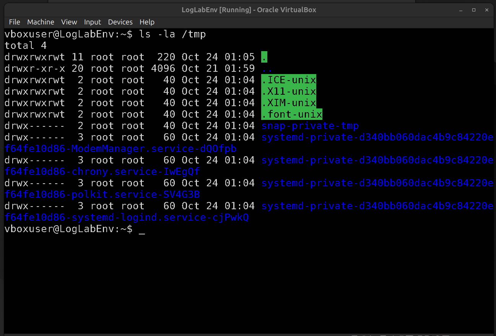
_Auditing the `/tmp` directory._

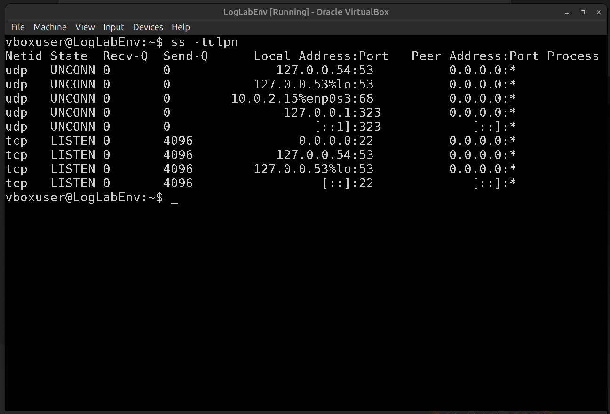
_Establishing the baseline open network ports._

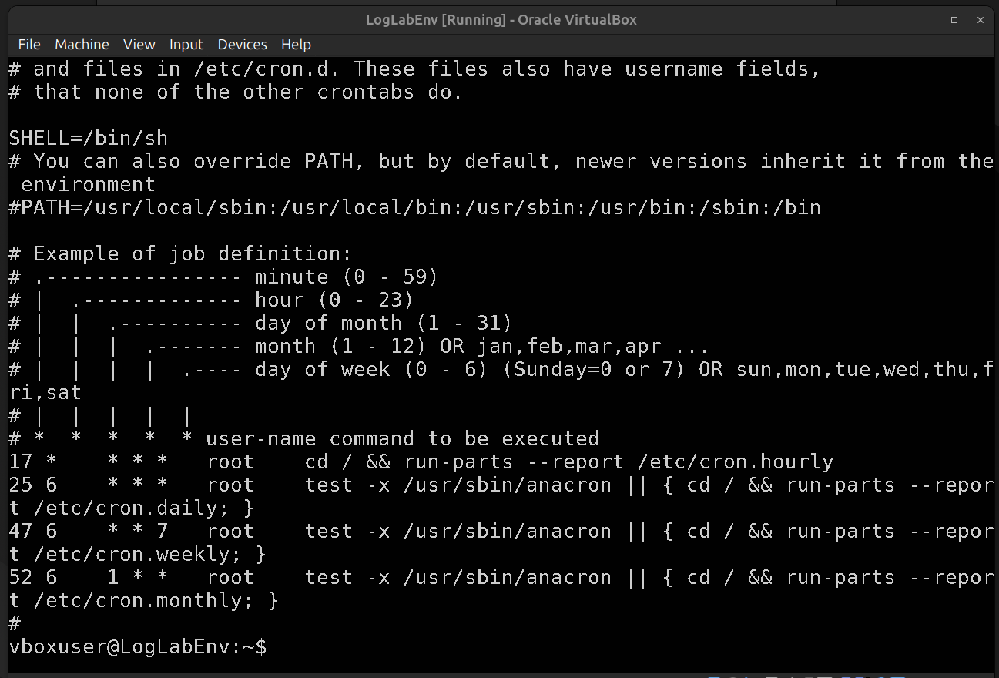
_Reviewing the default system crontab._

### Step 2: Attack Simulation (LotL)

Simulating an attacker using native tools to evade detection.

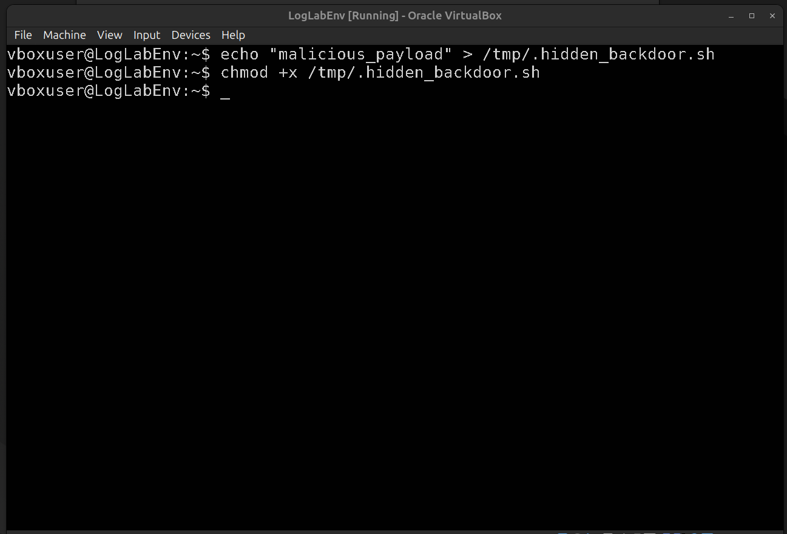
_Creating a hidden payload in the `/tmp` directory._

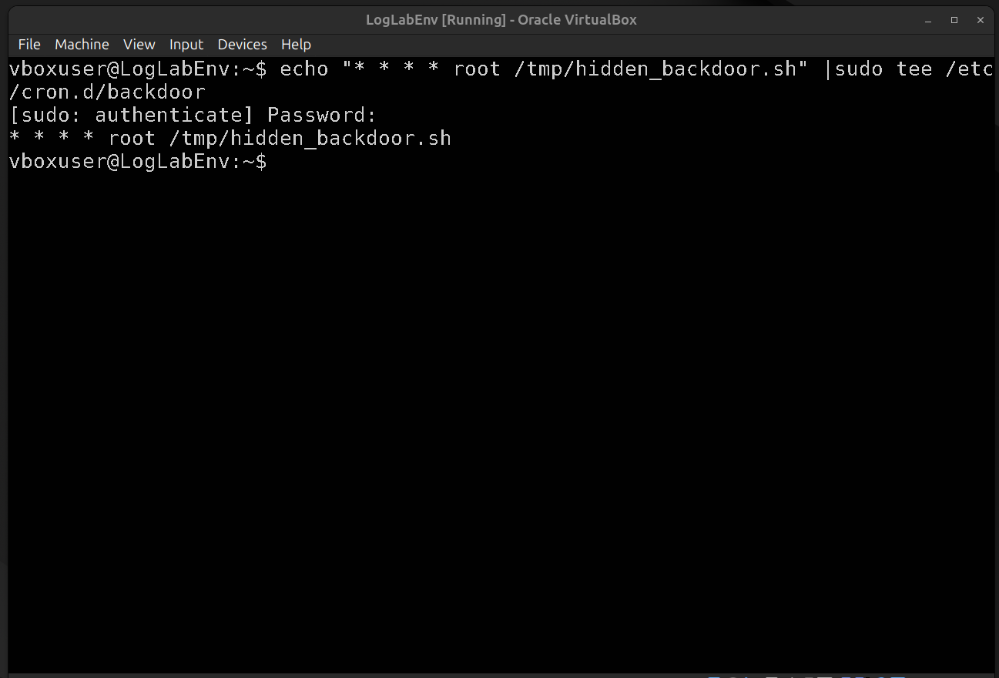
_Establishing persistence via `/etc/cron.d/`._

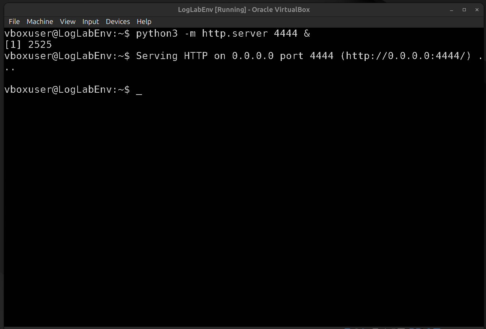
_Launching a simulated C2 backdoor on port 4444._

### Step 3: Threat Hunting

Hunting for the Indicators of Compromise (IOCs).

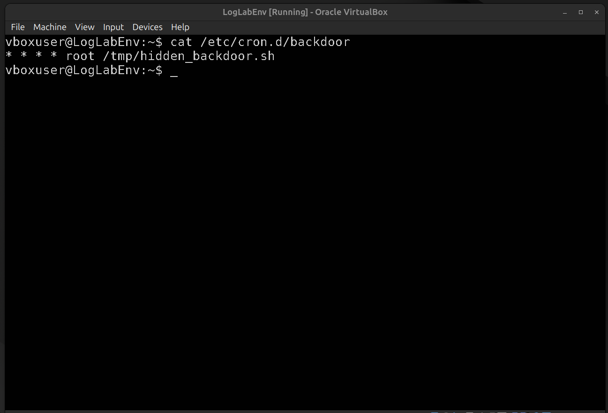
_Detecting the malicious cron file._

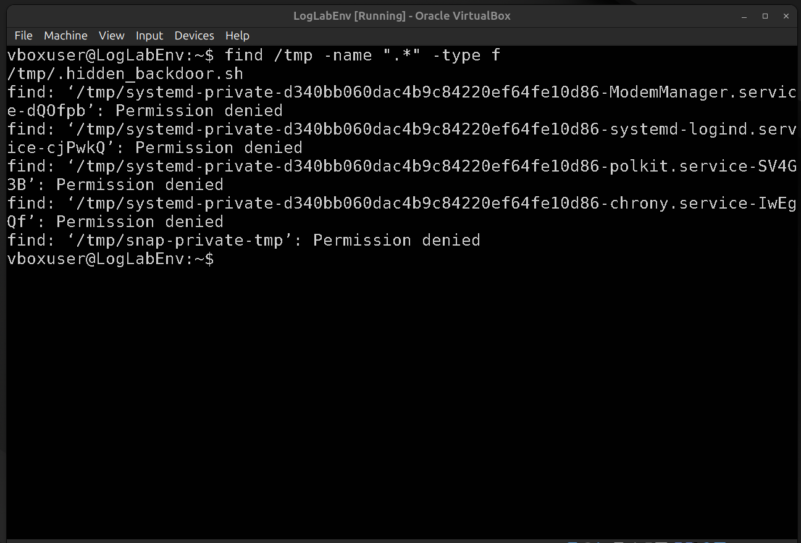
_Using `find` to reveal the hidden payload._

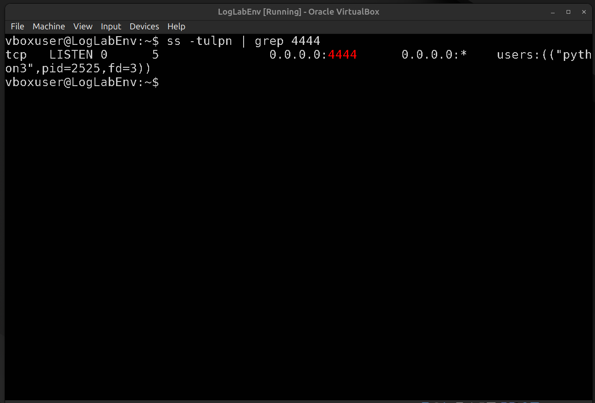
_Detecting the active backdoor listening on port 4444._

### Step 4: Incident Response & Verification

Neutralizing the threat and proving the system is secure.

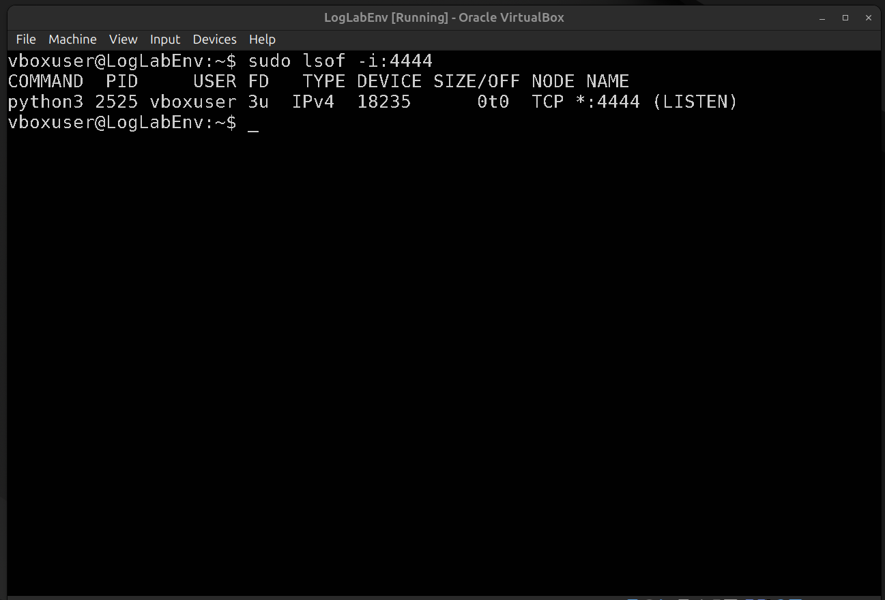
_Using `lsof` to identify the Process ID (PID) of the backdoor._

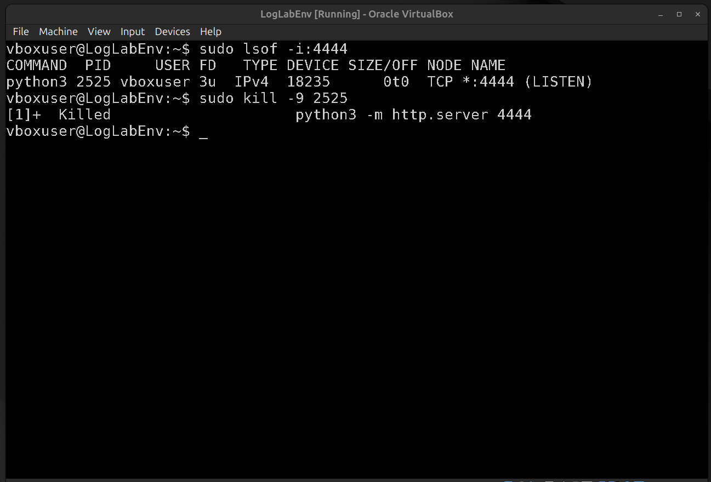
_Forcefully terminating the malicious process._

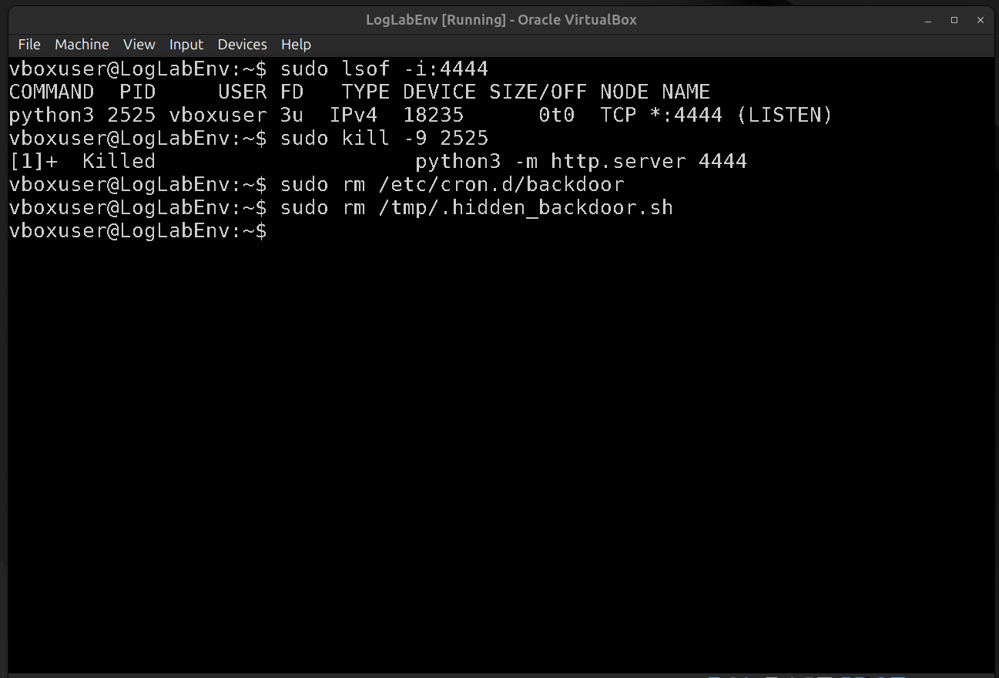
_Removing the cron job and hidden payload._

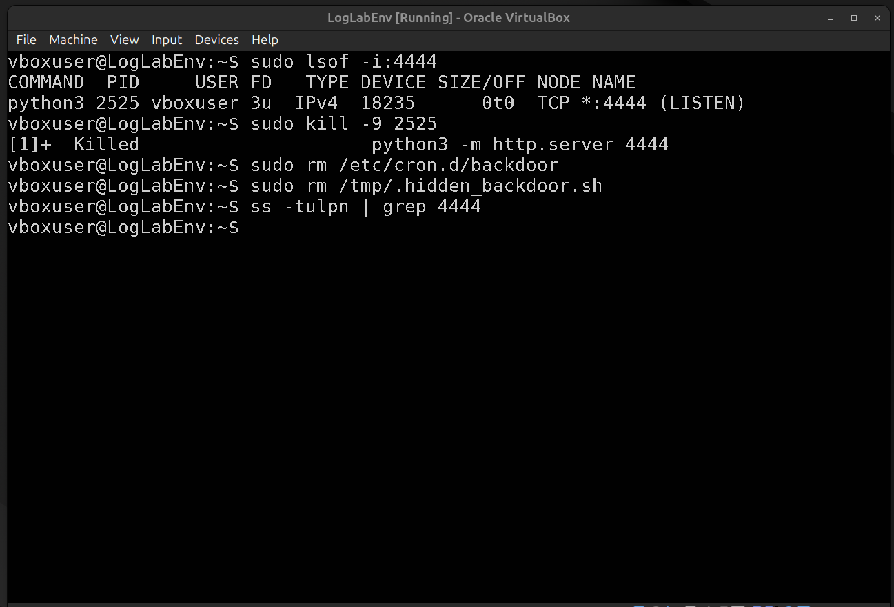
_Verifying the port is closed and the system is clean._

## Lessons Learned

- **The Danger of LotL:** An attacker doesn't need to download a virus. They can use built-in tools like `python3` and `cron` to compromise a system.
- **Hiding in Plain Sight:** The `ls` command does not show hidden files (those starting with a `.`). Threat hunters must use `ls -la` or `find` to uncover them.
- **Trust, but Verify:** After killing a process, always re-run your network scan (`ss -tulpn`) to ensure the attacker didn't establish a secondary backdoor.

##  Remediation

See [remediation.md](remediation.md) for defense-in-depth recommendations.
