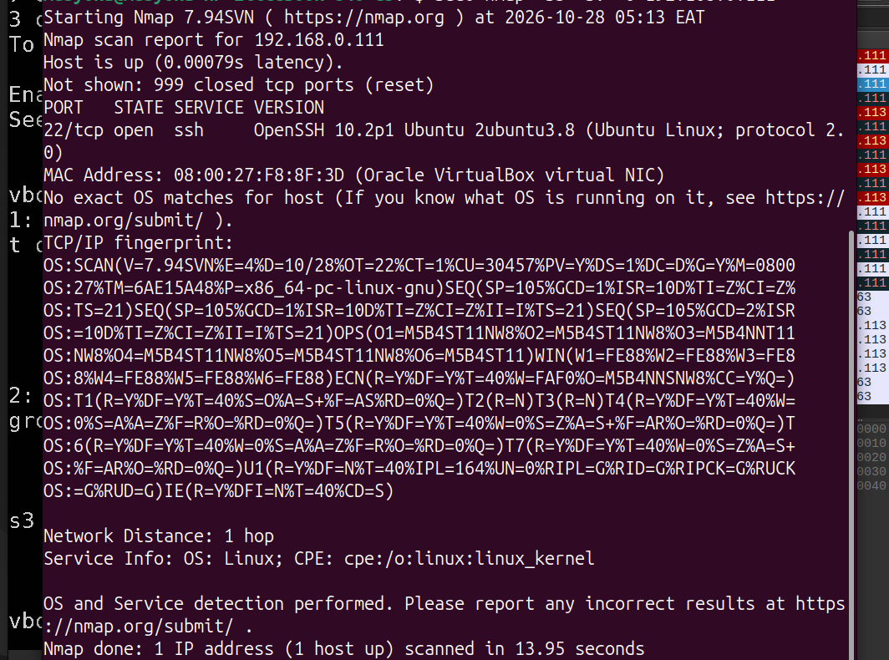
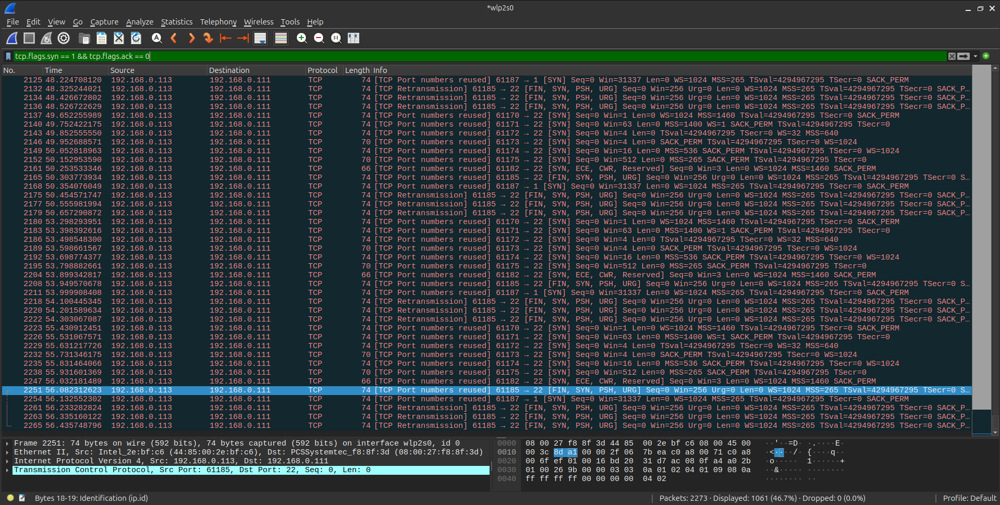
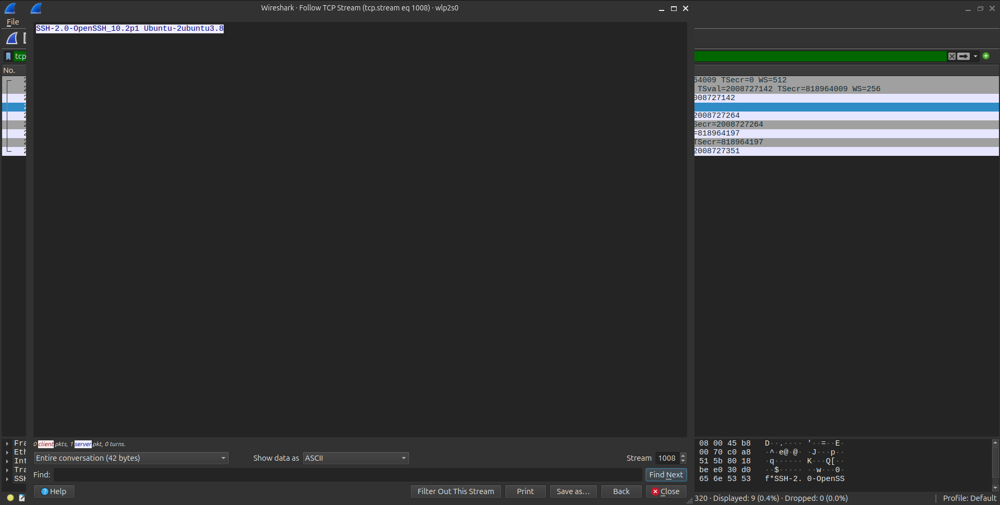

# Network Reconnaissance & Service Fingerprinting

## Overview

This project simulates the initial reconnaissance phase of a cyberattack. Before an adversary exploits a network, they map it. This lab demonstrates how to use Nmap to perform network sweeps, identify open ports, and fingerprint operating systems and services.

Crucially, this project also captures the Nmap traffic in Wireshark to prove how TCP scans operate at the packet level, teaching the analyst how to detect reconnaissance from a defender's perspective.

## The Evidence

- **Environment:** Ubuntu Laptop (Attacker) vs. Headless Ubuntu Server VM (Target).
- **Tools Used:** Nmap, Wireshark.

## The Scenario

You are a security auditor tasked with mapping an unknown server on the internal network to identify potential entry points and exposed services.

## Investigation Walkthrough

### Phase 1: The Deep Service Scan

Using Nmap, a Stealth SYN Scan (`-sS`), version detection (`-sV`), and OS fingerprinting (`-O`) were run against the target VM.

- **The Finding:** The scan revealed port 22 (SSH) open, running OpenSSH 10.2p1.

_The Nmap terminal output identifying the open port and OS._

### Phase 2: The Packet Level (Detection)

A defender cannot always see the Nmap console, but they can see the network traffic. We captured the scan in Wireshark.

- **The Finding:** A rapid succession of TCP `[SYN]` packets from the attacker IP to the victim IP, attempting to initiate connections to various ports.

_Wireshark capturing the SYN scan traffic._

### Phase 3: Service Banner Grabbing

To identify the exact software version, a TCP Connect scan (`-sT`) was used. This completed the TCP handshake, forcing the server to send back its SSH banner.

- **The Finding:** The `SSH-2.0-OpenSSH_10.2p1` banner was captured in plain text.

_Following the TCP stream to extract the service banner._

## Lessons Learned

- **Stealth vs. Connect:** A `-sS` (SYN) scan is stealthier because it never completes the TCP handshake. A `-sT` (Connect) scan is louder but necessary to grab service banners.
- **Reconnaissance is noisy:** From a defender's perspective, hundreds of SYN packets hitting different ports in a second is a massive red flag that should trigger a firewall block or IDS alert.
- **Version matters:** Knowing a server runs `OpenSSH 10.2` allows an attacker to search for specific CVEs associated with that exact version.
