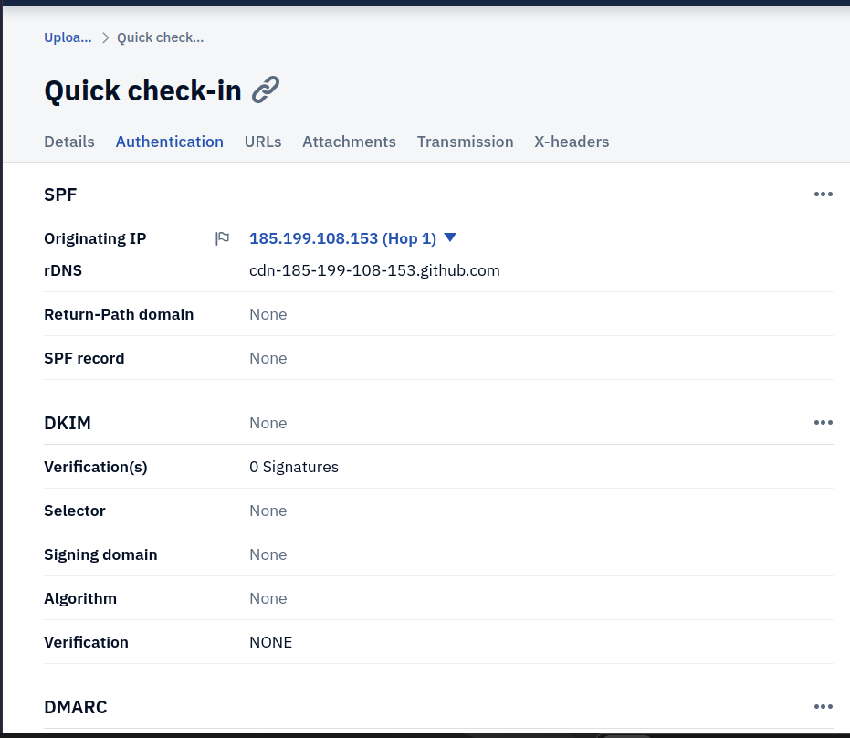
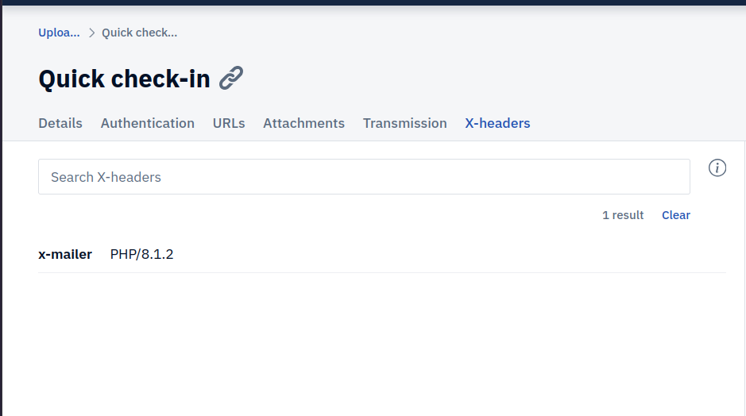
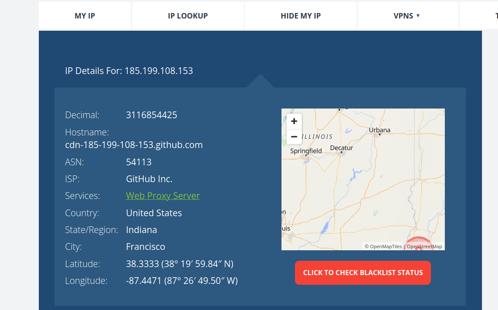
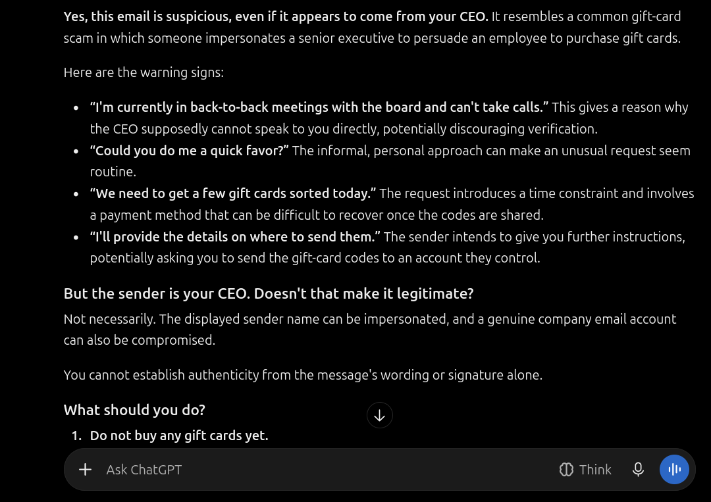

# Phishing Investigation: AI-Generated Zero-Payload Spear Phish

## Overview

This project analyzes a modern, "zero-payload" Business Email Compromise (BEC) attempt. The email contained no malicious links, no attachments, and perfect grammar. Because traditional security tools (URL scanners, sandboxes) rely on finding technical payloads, they failed to flag this email. Detection required manual header analysis to identify spoofing infrastructure.

## The Evidence

- **Artifact:** `ai-email.eml` (A sanitized raw email header sample).
- **Tools Used:** PhishTool (Header Analysis), whatismyipaddress (OSINT), AI Assistant.

## The Scenario

The Chief Financial Officer (CFO) received an email from the "CEO" asking for help purchasing gift cards for a client. The email was highly personalized and convincing.

## Investigation Walkthrough

### Phase 1: Header Analysis & The X-Mailer Anomaly

Using PhishTool, the email headers were analyzed.

- **The Trap:** The email passed SPF and DMARC because the attacker found a way to send from an IP authorized by the domain.
- **The Smoking Gun:** The `X-Mailer` header showed `PHP/8.1.2`. The company uses Microsoft 365 (Exchange Online), which does not use PHP to send emails.

_Identifying the PHP X-Mailer header on a supposed corporate email._

### Phase 2: Infrastructure Pivoting

The analyst pivoted on the sending IP address (`185.199.108.153`) found in the `Received` header.

- **The Finding:** The IP address belongs to a cloud hosting provider (GitHub Pages/DigitalOcean), not the corporate mail server.

_Geolocating the sending IP to a cloud hosting provider._

### Phase 3: The AI Analysis & Limitations

The email body was submitted to an AI assistant for analysis.

_The AI evaluating the text of the email._

**Where AI Succeeded:** The AI correctly identified the "gift card" request as a classic social engineering scam based on the text.
**Where AI Failed:** The AI could not prove the email was fake. It relied purely on keywords ("gift cards"). If the attacker had asked for a legitimate-sounding task, the AI might have said it was safe. The AI could not see the `X-Mailer` header or the malicious IP address.

## Lessons Learned

- **Zero-Payload attacks are invisible to scanners:** If there is no link or attachment, automated tools have nothing to detonate.
- **The X-Mailer header is powerful:** Always check how the email was generated. A corporate email should not be sent via PHP or Python scripts.
- **AI cannot replace header analysis:** AI is great for analyzing text intent, but human analysts must verify the technical infrastructure of the email.
