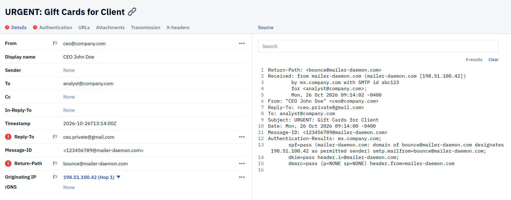
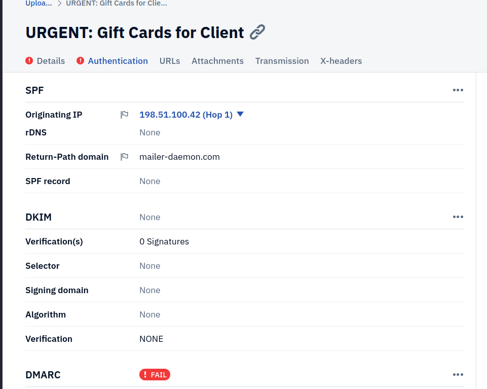
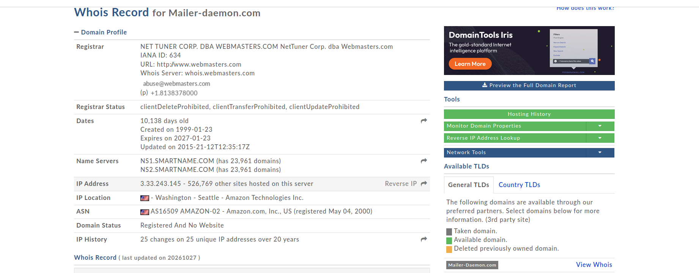
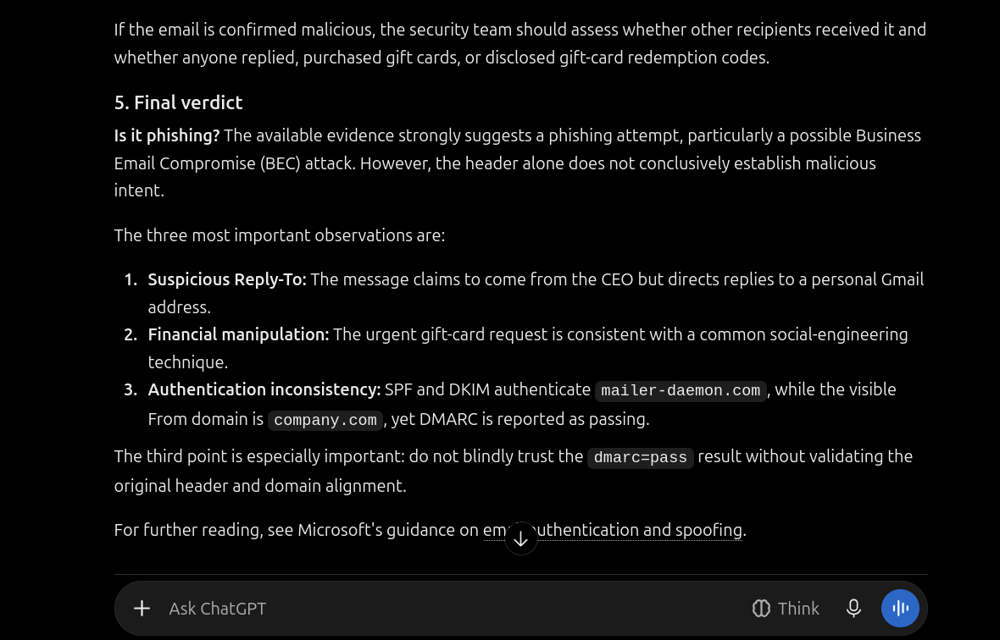

# Phishing Investigation: CEO Gift Card Scam (BEC)

## Overview

This project documents the investigation of a Business Email Compromise (BEC) attack. The objective was to analyze raw email headers, identify the spoofing technique, and demonstrate how manual investigation and OSINT enrich the findings provided by automated tools and AI.

## The Evidence

- **Artifact:** `ceo-giftcard.eml` (A sanitized email header sample).
- **Tools Used:** PhishTool (Header Analysis), WHOIS, AI Assistant.

## The Scenario

An employee received an urgent email from the "CEO" requesting gift cards. The email used a display name of the CEO but originated from an external server.

## Investigation Walkthrough

### Phase 1: Header Analysis & Authentication Failures

Using PhishTool, the email headers were analyzed.

- **The Finding:** While SPF passed, **DMARC failed**. This indicates the attacker attempted to spoof the `company.com` domain in the `From` header, but the receiving mail server correctly identified that the sending IP was not authorized.

_PhishTool identifying the DMARC failure and Reply-To mismatch._

### Phase 2: OSINT Verification

A WHOIS lookup was performed on the sending infrastructure. The attacker leveraged a high-reputation domain (`mailer-daemon.com`) for the Return-Path to bypass basic spam filters, while failing the alignment check for the actual spoofed domain.

_Verifying the sending domain infrastructure._

### Phase 3: The AI Analysis & Limitations

The raw headers were submitted to an AI assistant for analysis.

_The AI analyzing the headers._

**Where AI Succeeded:** The AI correctly parsed the `DMARC=Fail` result and flagged the email as malicious.
**Where AI Failed:** The AI could not determine the _intent_ (the gift card scam), could not check real-time IP reputation on threat intelligence platforms, and provided generic advice rather than actionable SOC remediation steps. AI output must always be validated by a human analyst.

## Lessons Learned

- **The DMARC Alignment:** DMARC requires the `From` domain to align with the SPF or DKIM domain. Attackers often use a legitimate domain for the `Return-Path` (SPF pass) but spoof the `From` address, resulting in a DMARC failure.
- **Always check Reply-To:** The `Reply-To` was set to a free Gmail account (`ceo.private@gmail.com`), a classic BEC tactic to redirect the victim's response.
- **AI is a co-pilot:** AI is excellent for quick header parsing, but human context is required to understand the threat and response.
