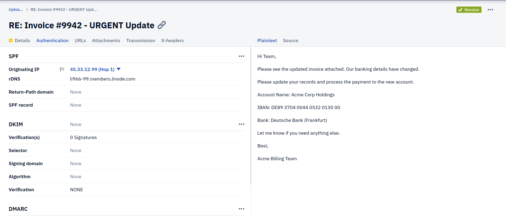
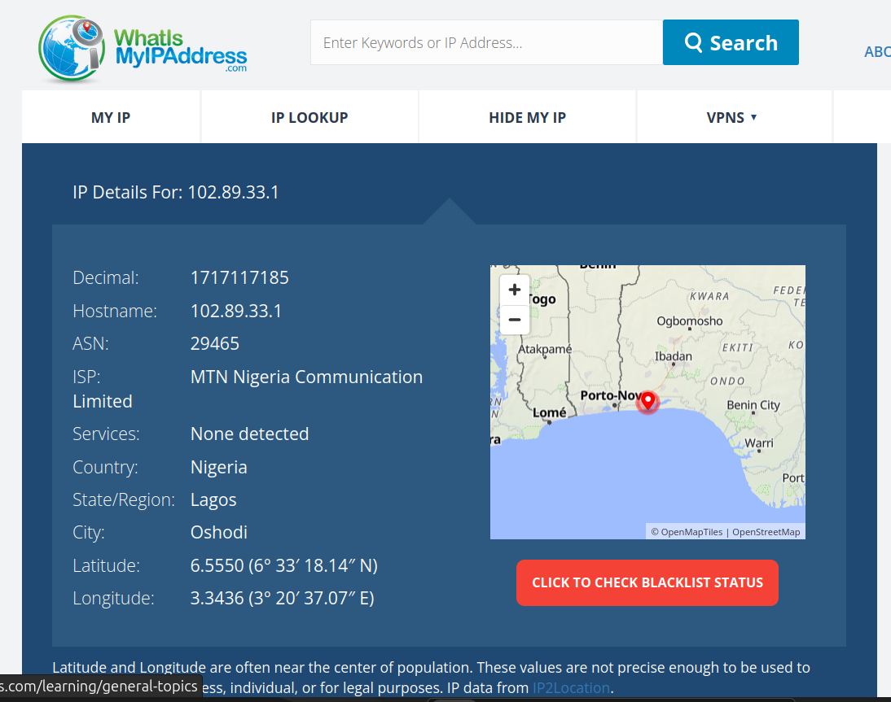
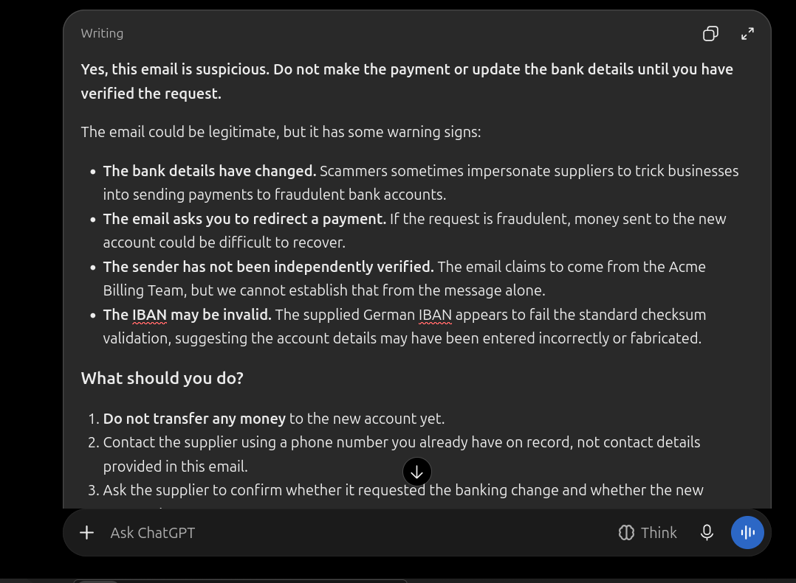

# Phishing Investigation: Thread Hijacking & Vendor Fraud

## Overview

This project documents the investigation of a Business Email Compromise (BEC) attack utilizing "Thread Hijacking." In this scenario, an attacker gains access to a legitimate vendor's email account and replies to an existing email thread. Because the email originates from the real account, it bypasses standard email authentication (SPF/DKIM/DMARC). Detection relies on behavioral analysis and infrastructure pivoting.

## The Evidence

- **Artifact:** `vendor-email.eml` (A sanitized raw email header sample).
- **Tools Used:** PhishTool (Header Analysis), whatismyipaddress (Geolocation), AI Assistant.

## The Scenario

An accountant was corresponding with a vendor (Acme Corp) regarding Invoice #9942. The vendor replied to the thread with an urgent request to update their banking details to a new account in Germany.

## Investigation Walkthrough

### Phase 1: Authentication Validation

The email headers were analyzed using PhishTool.

- **The Finding:** The email passed SPF, DKIM, and DMARC.
- **Analysis:** The attacker did not spoof the email. They successfully compromised the vendor's actual email account (`billing@vendor-domain.com`) and sent the reply from the real infrastructure.

- Email authentication results showing SPF/DKIM/DMARC passes.\*

### Phase 2: Infrastructure Pivoting (The Anomaly)

Because the authentication passed, technical controls failed. The analyst pivoted on the sending IP address (`102.89.33.1`) found in the `Received` header.

- **The Finding:** The IP address geolocates to Lagos, Nigeria.
- **Analysis:** The vendor is a US-based company. A sudden login and email transmission from Nigeria is a massive "Impossible Travel" anomaly, indicating the account was compromised by an external threat actor.

- Geolocating the sending IP address to Nigeria.\*

### Phase 3: The AI Analysis & Limitations

The email body was submitted to an AI assistant asking if it was suspicious.

- The AI evaluating the email body.\*

**Where AI Succeeded:** It correctly identified that changing banking details over email is a common fraud tactic.
**Where AI Failed:** It failed to identify the account compromise. Without being able to parse the raw headers and geolocate the IP, the AI provided generic advice ("call the vendor") but could not provide a definitive verdict that the vendor's email account was actively hacked.

## Lessons Learned

- **Authentication is not Context:** SPF/DKIM/DMARC only prove that the email came from a server authorized to send for that domain. If the actual user account is hacked, authentication will pass.
- **Verify out-of-band:** Whenever banking details change, the analyst and the business must verify via a known phone number, not by replying to the email.
- **Impossible Travel:** Monitoring login geolocations is a critical alerting mechanism for SOC teams.
