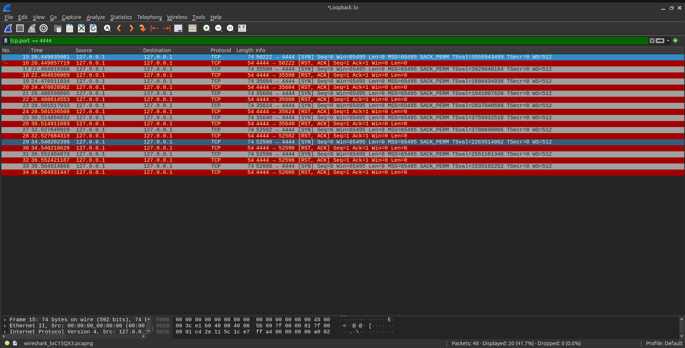
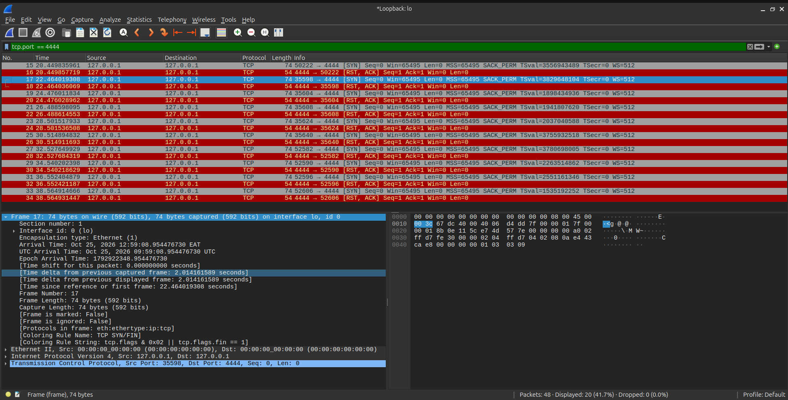

# Wireshark Traffic Analysis: Command & Control (C2) Beaconing

## Overview

This project simulates and investigates Command & Control (C2) beaconing. In a real-world cyberattack, malware rarely executes its payload instantly. Instead, it "beacons" (phones home) to an attacker-controlled server at regular intervals to check for new instructions. Detecting this rhythmic traffic pattern is a core SOC analyst skill.

## Environment

- OS: Ubuntu LTS
- Tools Used: Wireshark, Bash, Netcat (nc)

## The Scenario

1. Traffic Generation: A Bash loop simulated a compromised host sending a heartbeat signal to an external server every 2 seconds.
2. Packet Capture: Intercepted the traffic on the loopback interface (lo) on port 4444.
3. Investigation: Filtered the traffic to isolate the C2 channel and analyzed the packet timing (Time Delta) to prove the automated, rhythmic nature of the malware.

## Investigation Walkthrough

### 1. The Beacon Traffic

Filtering for port 4444 reveals a repetitive sequence of connection attempts. Unlike normal user browsing which happens in bursts, this traffic is perfectly timed.

_The repetitive connection attempts to the C2 port._

### 2. Analyzing the Time Delta

By expanding the Frame details of the subsequent packets, we can measure the exact time gap between connections. A consistent 2-second delta indicates automated malware rather than human activity.

_The Time Delta proving the beaconing interval._

## Lessons Learned

- Malware is predictable: Humans are random, but scripts are precise. A consistent time interval between connections is a massive red flag.
- Low and slow: The beacon packets are tiny (74 bytes). If the analyst is only looking for large data transfers, they will miss the initial infection.
- Port 4444: While not exclusively malicious, Port 4444 is the default Metasploit listener port and is commonly used by threat actors for reverse shells.
