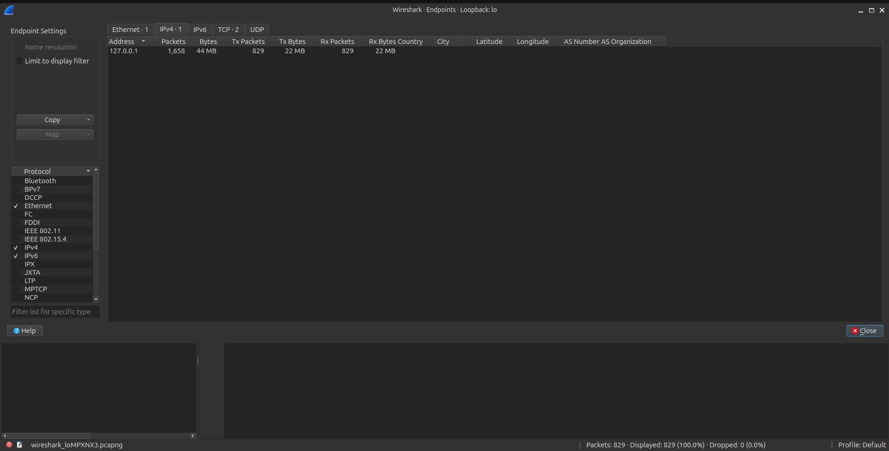
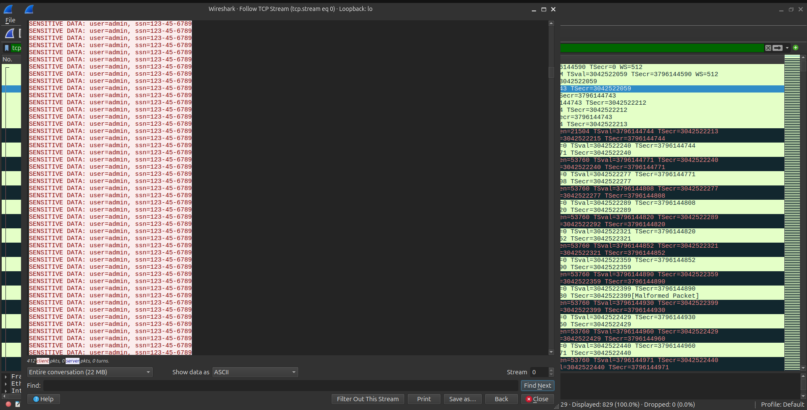

# Wireshark Traffic Analysis: Data Exfiltration

## Overview

This project simulates a Data Exfiltration event. In a corporate environment, attackers often steal sensitive data (like customer PII, credentials, or databases) and send it out of the network. As a SOC analyst, identifying this outbound traffic is critical to stopping a breach.

## Environment

- **OS:** Ubuntu LTS
- **Tools Used:** Wireshark, Python3, Netcat (`nc`)

## The Scenario

1. **Traffic Generation:** A Python script generated 500,000 lines of simulated sensitive data (SSN, usernames) and piped it to port 80 on the localhost.
2. **Packet Capture:** Intercepted the traffic on the loopback interface (`lo`).
3. **Investigation:** Analyzed the Wireshark Endpoint statistics to identify the data spike and used "Follow TCP Stream" to reconstruct the stolen data.

## Investigation Walkthrough

### 1. Identifying the Anomaly (Endpoints)

Looking at the Wireshark Endpoints statistics, we can immediately see a massive spike in data transfer. In a real SOC, this triggers an alert for unusual outbound traffic.

_The IPv4 Endpoint statistics showing the bulk data transfer between localhost._

### 2. Reconstructing the Stolen Data (TCP Stream)

By filtering for the traffic and following the TCP stream, we can read the exact data the attacker was sending out.

_The raw data stream revealing the exfiltrated simulated PII._

## Lessons Learned

- **Baseline is Everything:** 44MB is small in the real world, but if a server normally only sends 1MB of data a minute, a 44MB spike is a massive anomaly.
- **Cleartext is dangerous:** Because the attacker used port 80 (HTTP) without encryption, we could read the exact data they stole.
- **Automation leaves fingerprints:** The data stream showed a repeating, identical pattern. SOC analysts use this to differentiate human activity from automated malware scripts.
