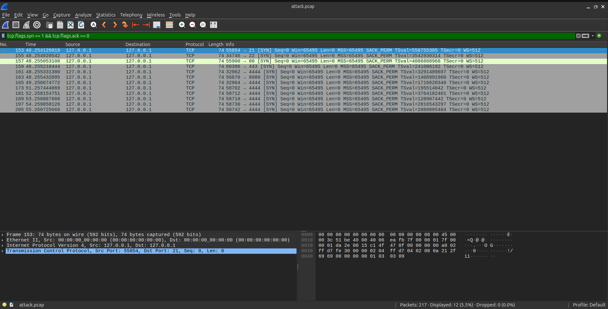
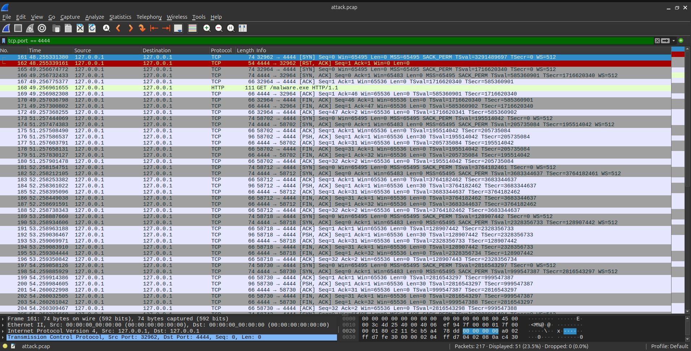
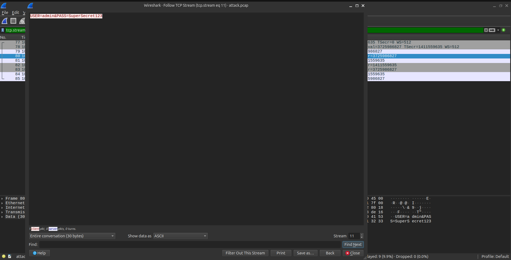

# Network Forensics: Multi-Stage Intrusion Investigation

## Overview

This project demonstrates advanced Network Forensics and Incident Response skills. Instead of analyzing isolated events, this lab captures and analyzes a complete, multi-stage cyberattack lifecycle within a PCAP file.

The objective is to act as a SOC Analyst responding to an alert, reconstructing the attack timeline, identifying the Indicators of Compromise (IOCs), and documenting the findings for an incident report.

## The Evidence

- **The PCAP File:** The raw packet capture (`attack.pcap`) is included in this repository. You can download it and open it in Wireshark to verify the analysis.
- **Tools Used:** Wireshark, Python3 (for attack simulation).

## The Attack Lifecycle

The PCAP contains the following stages of an intrusion:

1. **Reconnaissance:** The attacker scans the target to identify open ports.
2. **Infection:** The victim requests a malicious file (`/malware.exe`) from a command-and-control (C2) server.
3. **Command & Control (C2):** The malware beacons home at regular intervals.
4. **Credential Exfiltration:** The malware transmits stolen credentials to the attacker in plain text.

## Investigation Walkthrough

### Phase 1: Reconnaissance (Port Scan)

Filtering for TCP SYN packets reveals the attacker probing multiple ports rapidly to find a way in.

_Identifying the initial network scan._

### Phase 2 & 3: Infection & C2 Beaconing

Filtering for the C2 port (4444) reveals the initial malware download followed by rhythmic beaconing.

_The sequence of connections between the victim and the C2 server._

### Phase 4: Credential Theft (Follow TCP Stream)

By following the TCP stream of the beacon packets, we can extract the exact data the malware exfiltrated.

_Extracting plain-text credentials from the C2 channel._

## Key Takeaways

- **Context is everything:** A single port connection is not an attack. But a port scan followed by a file download, followed by rhythmic beaconing, tells a complete story.
- **The value of PCAPs:** Firewall logs might show a connection to port 4444, but only a PCAP can show you the _exact payload_ (the stolen password) being transmitted.
- **Cleartext C2:** Attackers often use cleartext protocols to blend in with normal web traffic, making it easy for defenders to read their commands if they know where to look.
