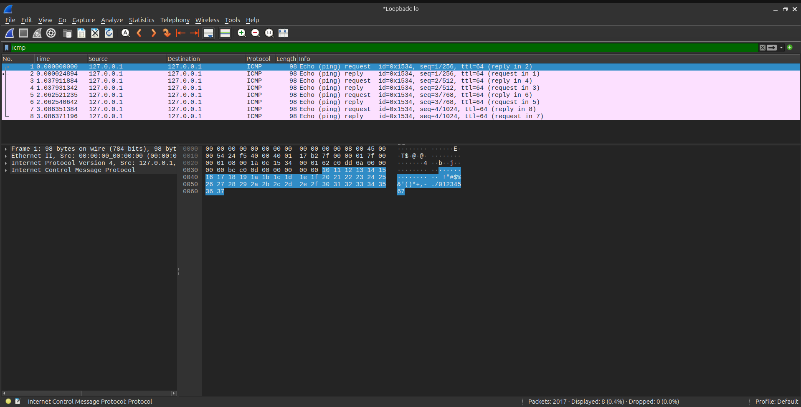
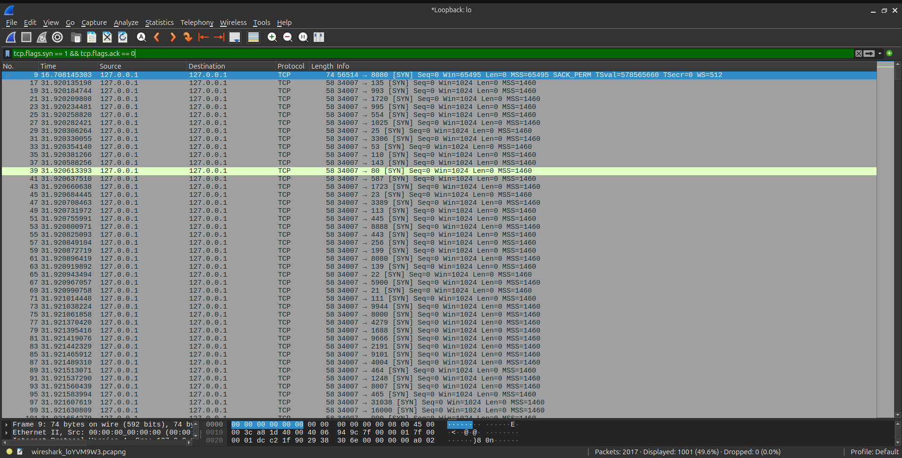
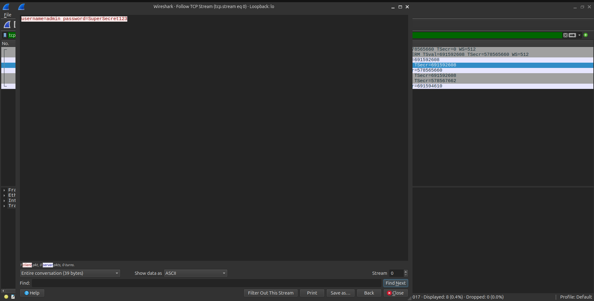

# Wireshark Traffic Analysis: Local Loopback & PCAP Forensics

## Overview

This project demonstrates foundational Network Forensics skills using Wireshark on Ubuntu. The objective was to capture live network traffic on the loopback interface (`lo`), simulate a basic network attack (port scanning and plaintext credential transmission), and investigate the resulting PCAP data.

## Environment

- **OS:** Ubuntu LTS
- **Tools Used:** Wireshark, `nmap`, `netcat` (`nc`), `ping`

## The Scenario

1. **Traffic Generation:** Simulated normal traffic (ICMP), a stealth TCP port scan, and a plaintext credential transmission over TCP port 8080.
2. **Packet Capture:** Used Wireshark to intercept the traffic on the local loopback interface.
3. **Investigation:** Applied display filters to isolate the port scan and extract the plaintext password from the packet bytes.

## Investigation Walkthrough

### 1. Normal Traffic (ICMP)

Filtered for `icmp` to isolate basic ping requests and replies.

_Verifying connectivity via ICMP packets._

### 2. The Attack (Port Scan)

Filtered for `tcp.flags.syn == 1 && tcp.flags.ack == 0` to identify a stealth port scan (SYN scan) generated by Nmap.

_Identifying connection attempts to multiple ports, indicative of a port scan._

### 3. Data Exfiltration (Plaintext Credentials)

Filtered for `tcp.port == 8080` and inspected the packet bytes to reveal a simulated password sent over the network without encryption.

_Extracting `username=admin password=SuperSecret123` from the raw packet bytes._

## Lessons Learned

- **Filters are mandatory:** Without display filters, finding a single malicious packet among thousands of background noise packets is impossible.
- **Clear-text is a vulnerability:** Any data sent over unencrypted protocols can be read by anyone with access to the network segment.
- **Port scans are loud:** A stealth scan might hide from basic firewall logs, but it is glaringly obvious in a packet capture.
