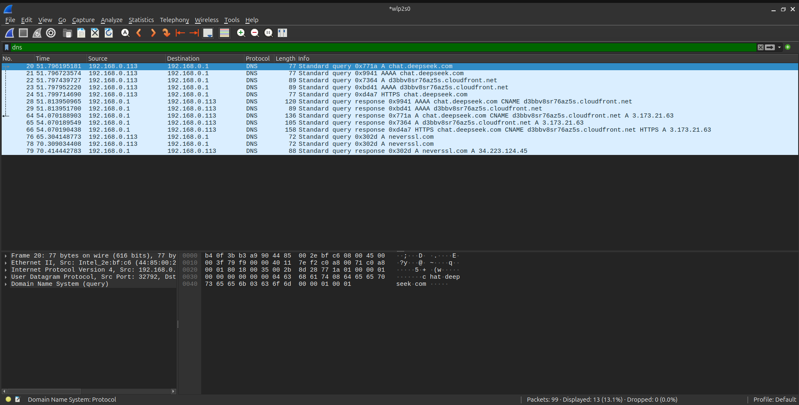
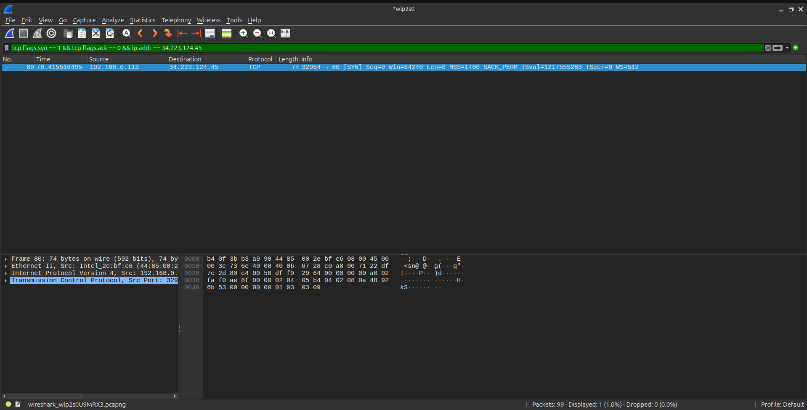
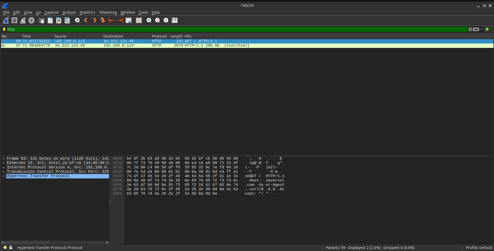

# Wireshark Traffic Analysis: Web Traffic & DNS Forensics

## Overview

This project demonstrates the ability to capture and analyze web traffic (HTTP) and Domain Name System (DNS) queries. As a SOC analyst, investigating web traffic is critical, as the vast majority of malware infections begin with a user visiting a malicious website or downloading a payload via HTTP.

## Environment

- **OS:** Ubuntu LTS
- **Tools Used:** Wireshark, `curl`, `resolvectl`

## The Scenario

1. **Traffic Generation:** Cleared the local DNS cache and used `curl` to request a non-encrypted website (`http://neverssl.com`).
2. **Packet Capture:** Intercepted the traffic on the active Wi-Fi interface (`wlp2s0`).
3. **Investigation:** Filtered the capture to isolate the DNS query, the TCP 3-way handshake, and the HTTP GET request.

## Investigation Walkthrough

### 1. DNS Resolution

Filtered for `dns` to observe the workstation requesting the IP address for `neverssl.com`. This is the first step in any web request.

_Figure 1: The DNS query and response resolving the domain name to an IPv4 address._

### 2. The TCP Handshake

Filtered for `tcp.flags.syn == 1` and the target IP to observe the TCP 3-way handshake. This establishes the reliable connection before data can be sent.

_Figure 2: The initial SYN packet initiating the connection to the web server._

### 3. The HTTP Request

Filtered for `http` to find the actual web request. Because the site uses HTTP (port 80) instead of HTTPS, the entire request is readable in plain text.

_Figure 3: Inspecting the HTTP GET request, revealing the Host and User-Agent._

## Lessons Learned

- **The Web is Noisy:** Capturing on a Wi-Fi card generates massive amounts of background noise. Display filters (like `dns` and `http`) are mandatory.
- **DNS comes first:** You cannot connect to a website by name without a DNS query occurring first. Monitoring DNS is a primary defense against malware.
- **HTTPS matters:** Because we used HTTP, we could read the `Host` and `User-Agent`. If this were HTTPS, the data would be encrypted.
